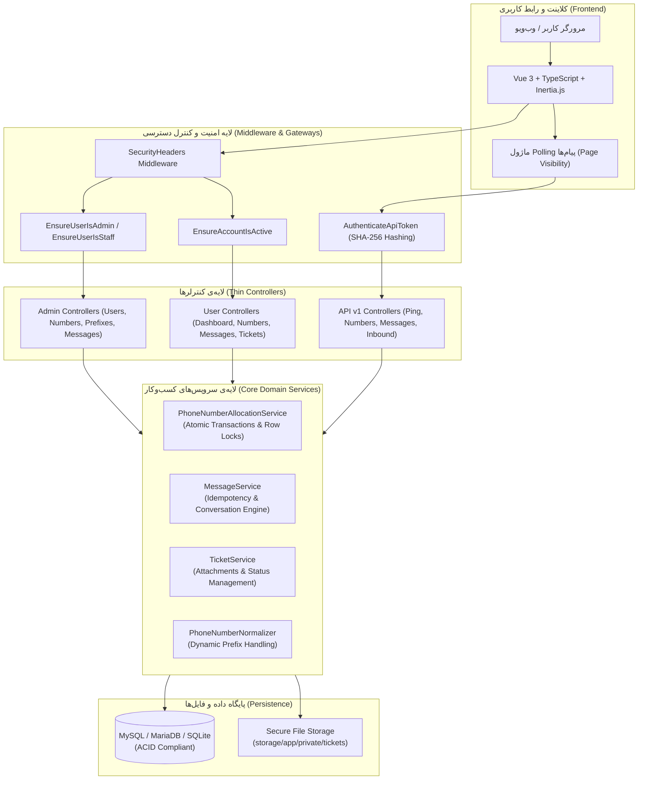
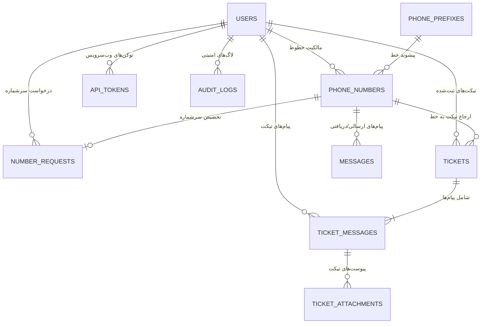
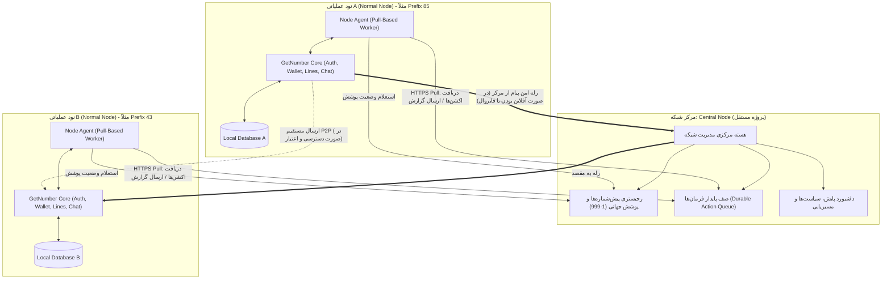

# معماری کلان سامانه GetNumber (System Architecture Specification)
### Current Architecture Baseline & Multi-Node Target Architecture

> **مرجع سیستم:** مخزن [GetNumber on GitHub](https://github.com/shanaqisaeed/GetNumber)  
> **نسخه سند:** 1.0.0 (Phase 0 Baseline)  
> **نقش جاری مخزن:** Normal Node مستقل (Enterprise Virtual Number Node)

---

## ۱. نمای کلی و معماری فعلی (Current System Architecture)

پروژه حاضر بر پایه **Laravel 13** و **Vue 3 (Inertia.js v2)** پیاده‌سازی شده است و تمامی رفتارهای یک نود ارتباطی مستقل (Normal Node) را پوشش می‌دهد.

### ۱.۱. پشته فناوری (Technology Stack)
- **موتور بک‌اند:** PHP 8.3+ با استفاده از Strict Typing و Enums بومی.
- **فریم‌ورک هسته:** Laravel 13.x.
- **لایه فرانت‌اند:** Vue 3 (Composition API، اسکریپت تایپ‌اسکریپت `<script setup lang="ts">`) و Inertia.js 2.0 بدون تاخیر SPA سنتی.
- **طراحی رابط کاربری:** Tailwind CSS با معماری RTL بومی و دارک‌مود استاندارد، همراه با فونت‌های آفلاین محلی Vazirmatn.
- **پایگاه داده:** MariaDB 10.4+ / MySQL 8.0+ در محیط عملیاتی و SQLite در محیط تست‌های خودکار.
- **تضمین کیفیت:** ۱۸۸ تست Feature و Unit پاس‌شده خودکار.

### ۱.۲. دیاگرام مؤلفه‌های معماری جاری (Component Architecture)

---

## ۲. بررسی ساختار موجود دیتابیس و روابط مدل‌ها (Database Entities)

### جداول اصلی و کارکرد آن‌ها:
1. `users`: نگهداری حساب‌های کاربری با شناسه‌های `username`، نقش‌ها (`admin`, `agent`, `user`) و وضعیت (`active`, `suspended`, `inactive`).
2. `phone_prefixes`: جدول داینامیک پیشوندها (`+85`, `+98` و غیره) با قابلیت تعیین پیشوند پیش‌فرض سیستم و وضعیت فعال/غیرفعال.
3. `phone_numbers`: نگهداری شماره‌های استاندارد ۹ رقمی (`user_standard`) و سرشماره‌های ۴ تا ۸ رقمی تجاری (`user_service` و `platform_service`) همراه با وضعیت‌های `available`, `allocated`, `reserved`, `suspended`, `inactive`, `expired`.
4. `number_requests`: گردش کار درخواست سرشماره توسط کاربر، ثبت دلیل، بررسی ادمین، تأیید و تخصیص یا رد همراه با درج بازخورد.
5. `messages`: پیام‌های متنی با پشتیبانی از جهت (`inbound` یا `outbound`)، ثبت تاریخچه زمانی سرور، و قید یکتایی ترکیبی `(source_system_id, client_message_id)` جهت جلوگیری از ثبت تکراری وب‌هوک‌ها (Idempotency).
6. `api_tokens`: کلیدهای ارتباطی وب‌سرویس ذخیره‌شده به شکل هش یک‌طرفه `SHA-256` با تفکیک دقیق توانمندی‌ها (`abilities`) و ثبت تاریخ آخرین استفاده.
7. `audit_logs`: دفترکل ثبت رویدادهای حساس، تغییرات وضعیت خطوط، احراز هویت، صدور توکن‌ها همراه با جزئیات JSON و آدرس IP.
8. `tickets`, `ticket_messages`, `ticket_attachments`: ساختار تیکتینگ پشتیبانی با کدهای پیگیری `TK-XXXXX`، دپارتمان‌ها، اولویت‌ها و ذخیره‌سازی محافظت‌شده فایل‌های پیوست.

---

## ۳. تحلیل معماری هدف: تفکیک Normal Node و Central Node

طبق منشور توسعه پروژه، معماری از تک‌نود به یک زیرساخت توزیع‌شده چندنودی (Multi-Node Distributed Infrastructure) ارتقا خواهد یافت:

---

## ۴. مرزبندی دقیق مسئولیت‌ها (Separation of Concerns)

| مؤلفه | مسئولیت‌های نود عادی (Normal Node) | مسئولیت‌های سرور مرکزی (Central Node) |
| :--- | :--- | :--- |
| **مالکیت کد و مخزن** | همین مخزن فعلی (`shanaqisaeed/GetNumber`) با حفظ قابلیت‌های موجود | پروژه کاملاً مجزا با ریپازیتوری مستقل و معماری اختصاصی |
| **مدیریت کاربران** | ثبت‌نام، احراز هویت، پروفایل و دسترسی‌های کاربران محلی | مدیریت و احراز هویت سازندگان و توسعه‌دهندگان نودها |
| **کیف پول و خرید** | کیف پول مستقل کاربر، موجودی COIN، پرداخت با TRX نوبیتکس، کسر هزینه خطوط | - |
| **مدیریت خطوط** | تخصیص خط به کاربران محلی بر اساس پیشوندهای مجاز اختصاص‌یافته | مرجع نهایی و انحصاری مالکیت، صدور و سلب پیش‌شماره‌ها در شبکه |
| **هویت در شبکه** | دارای `Global Node ID` و کلید عمومی/خصوصی جهت اعتبارسنجی | صادرکننده شناسه‌های یکتا، کنترل‌کننده وضعیت فعال/تعلیق نودها |
| **اجرای فرامین** | اجرای Pull-Based اکشن‌های دریافتی از سرور مرکزی (مانند مهاجرت پیش‌شماره) | ایجاد، زمان‌بندی، مانیتورینگ و لغو اکشن‌های مدیریتی |
| **رفتار در قطعی شبکه** | **کاملاً مستقل:** ادامه چت داخلی، خرید خط، مدیریت کاربران بدون توقف | حفظ پیام‌های ترانزیت و اکشن‌ها در صف‌های پایدار (Durable Queue) |

---

## ۵. پروتکل ارتباطی نودها (Node Communication & Security)

### ۵.۱. معماری Pull-Based و عدم وابستگی به IP ثابت
- نودهای عادی ملزم به داشتن IP استاتیک، دامین اختصاصی یا باز بودن پورت‌های ورودی به سمت اینترنت نیستند.
- سرویس `Node Agent` در نود عادی در بازه‌های زمانی منظم از طریق درخواست‌های خروجی HTTPS با هدرهای احراز هویت و امضای امنیتی به سرور مرکزی وصل شده و اکشن‌های تخصیص‌یافته را واکشی می‌کند.

### ۵.۲. امنیت و جلوگیری از حملات بازپخش (Replay Attack Protection)
تمامی تبادلات حساس بین نودها و سرور مرکزی ملزم به ارسال هدرهای زیر خواهند بود:
- `X-Node-ID`: شناسه یکتای جهانی نود.
- `X-Timestamp`: زمان دقیق بر حسب ISO 8601 (با پنجره اعتبار حداکثر ۳۰۰ ثانیه جهت جلوگیری از ارسال دیرهنگام).
- `X-Nonce`: رشته تصادفی یکبارمصرف جهت تضمین یکتایی درخواست.
- `X-Signature`: امضای دیجیتال محتوای درخواست با کلید نامتقارن یا Secret مشترک.

### ۵.۳. چرخه حیات اکشن‌ها (Action Lifecycle)
یک اکشن مدیریتی در سرور مرکزی دارای حالات زیر است:
`PENDING` -> `DELIVERED` -> `ACKNOWLEDGED` -> `RUNNING` -> `COMPLETED`  
(و در شرایط استثنا: `RETRYING`، `FAILED`، `EXPIRED`، `CANCELLED`، `SUPERSEDED`، `NEEDS_ATTENTION`).

دو مفهوم زمانی مستقل:
1. **Delivery Lease:** بازه زمانی که نود برای پردازش یک واکشی در اختیار دارد؛ در صورت قطع اینترنت در حین اجرا، Lease منقضی شده و اکشن مجدداً آماده تحویل می‌شود.
2. **Business Expiration:** تاریخ انقضای تجاری فرامین؛ فرامین حیاتی (نظیر مهاجرت پیش‌شماره) منقضی نمی‌شوند تا حتماً به اتمام برسند، در حالی که چک‌های دوره‌ای سلامت می‌توانند انقضای کوتاه داشته باشند.

---

## ۶. تحلیل نقاط حساس و استراتژی ارتقای سیستم (Risk Analysis & Mitigation)

1. **عملیات مالی کیف پول:**  
   - *ریسک:* Race Condition در خرید همزمان شماره یا شارژ حساب.  
   - *راهکار:* استفاده از ایزولاسیون تراکنش‌های دیتابیس، قفل سطری بدبینانه (`lockForUpdate`)، و جدول دفترکل (`wallet_transactions`) تغییرناپذیر با قیدهای یکتایی روی شناسه تراکنش و هش پرداخت.
2. **پیش‌شماره‌های هاردکدشده:**  
   - *ریسک:* وجود عبارات ثابت `+85` یا `85` در رجکس‌ها و صفحات فرانت‌اند.  
   - *راهکار:* جایگزینی با پیشوند داینامیک استخراج‌شده از دیتابیس و پاس داده‌شده به کامپوننت‌های Vue از طریق Shared Props در Inertia.
3. **پایداری پیام‌رسانی بلادرنگ:**  
   - *ریسک:* عدم امکان اتصال WebSocket در برخی شبکه‌های بسته‌ی اینترانت یا پروکسی‌ها.  
   - *راهکار:* پیاده‌سازی معماری ترکیبی با اولویت WebSocket (Laravel Reverb) و فال‌بک خودکار و بدون درز به Polling بهینه در زمان عدم برقراری اتصال سوکت.

