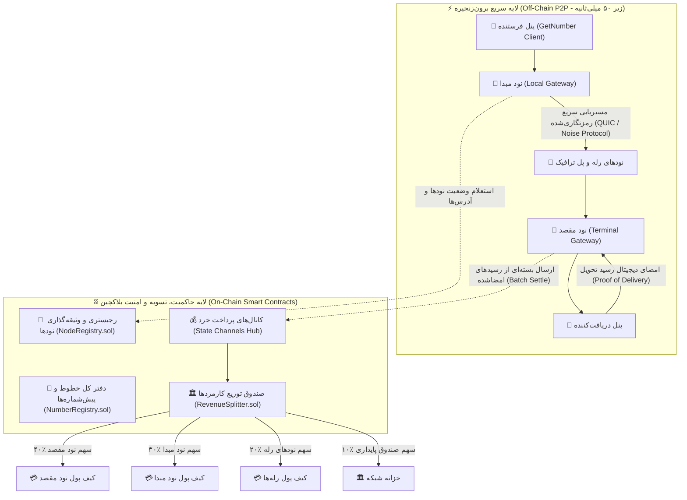
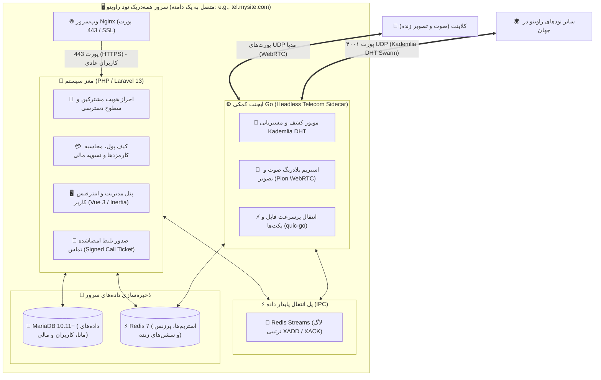

# ⛓️ سند جامع و راهبردی استقرار سامانه GetNumber بر بستر بلاکچین
## (Sovereign Decentralized Telecom & Micro-Fee Revenue Foundation Spec)

این سند مهندسی به عنوان **وایت‌پیپر فنی و مرجع پیاده‌سازی معماری نودهای بلاکچینی** سامانه GetNumber تدوین شده است. هدف این سند، تبدیل سامانه از یک اسکریپت وب به یک **«شبکه مخابراتی غیرمتمرکز، خودگردان و درآمدزا (DePIN Telecom Network)»** بر بستر فناوری زنجیره بلوکی است؛ شبکه‌ای که در آن هر کسی با نصب اسکریپت، یک گره درآمدزای مخابراتی فعال کرده و از طریق جابجایی ترافیک پیام‌ها، درآمدهای پایدار ارزی کسب می‌کند.

---

## ۱. مانیفست بنیادین و دگرگونی ماهیت سیستم (The Paradigm Shift)

در مخابرات سنتی، شرکت‌های دولتی یا چندملیتی با دکل‌های انحصاری میلیاردها دلار از پیامک و تماس درآمد کسب می‌کنند و کاربران را تحت سانسور و احراز هویت‌های اجباری قرار می‌دهند.
با استقرار GetNumber روی بلاکچین:
* **حذف سرور مرکزی و اپراتورهای دولتی:** شبکه مخابراتی بر روی مجموعه‌ای از نودهای توزیع‌شده متعلق به مردم و شرکت‌های خصوصی در سراسر دنیا زندگی می‌کند.
* **مالکیت ریاضی شماره‌ها:** خطوط مجازی و پیش‌شماره‌ها به صورت رکوردهای تغییرناپذیر (`Non-Fungible Digital Assets`) در بلاکچین قفل می‌شوند؛ هیچ نهادی توانایی مسدودسازی، سلب امتیاز یا شنود خطوط را نخواهد داشت.
* **فرانچایز مخابراتی درآمدزا:** هر صاحب نود بابت نگهداری سرور، رله کردن بسته‌ها و تحویل پیام‌ها به صورت آنی و خودکار کارمزدهای خرد (`Micro-Fees`) دلاری یا ارزی کسب می‌کند.

---

## ۲. معماری دولایه: درون‌زنجیره و برون‌زنجیره (On-Chain / Off-Chain Architecture)

یکی از مرگبارترین خطاهای معماری در پروژه‌های بلاکچینی، ذخیره‌سازی بدنه پیام‌ها روی بلاکچین است که منجر به کندی شدید، هزینه‌های سرسام‌آور گس و نقض حریم خصوصی می‌شود. 
برای دستیابی به عملکرد سازمانی، سیستم به صورت دو لایه مجزا مهندسی می‌شود:



### الف) لایه برون‌زنجیره (`Off-Chain Fast Engine`):
* ارسال و دریافت پیام‌ها در کسری از ثانیه (زیر ۵۰ میلی‌ثانیه) مستقیماً بین نودها و با پروتکل فوق‌سریع `QUIC` یا `WebSockets` جابجا می‌شود.
* متن تمام پیام‌ها با الگوریتم مشابه سیگنال (`Double Ratchet`) رمزنگاری سرتاسری شده و هیچ نودی در مسیر قادر به خواندن پیام نیست.

### ب) لایه درون‌زنجیره (`On-Chain Governance & Settlement`):
* ثبت پیش‌شماره‌ها و جلوگیری ۱۰۰٪ از تداخل خطوط.
* ثبت مشخصات عمومی نودها و استیکینگ وثیقه تضمین سلامت.
* اسکروی مالی و تسویه دسته‌ای کارمزدهای خرد بدون نیاز به پرداخت گس برای تک‌تک پیام‌ها.

---

## ۳. معماری اجرایی داخل نود: الگوی مغز و عضله (Laravel + Go Sidecar)

برای اینکه نود راوینو بدون نیاز به زیرساخت‌های پیچیده و پرهزینه، روی یک سرور مجازی معمولی (`Low-Cost VPS`) با بالاترین راندمان اجرا شود، استک نرم‌افزاری بر پایه **«مغز متفکر و ایجنت کمکی»** مهندسی شده است:

### اصل حاکمیت مطلق لاراول بر ایجنت Go:
* **لاراول مغز متفکر و تصمیم‌گیرنده نهایی است (`The Supreme Brain & Orchestrator`):** تمام تصمیم‌گیری‌های حساس، احراز هویت مشترکین، پایگاه داده اصلی، قوانین خطوط، کیف پول، صدور مجوزها، و ارتباطات سطح بالا در لاراول انجام می‌شود.
* **ایجنت Go صرفاً دستیار اجرایی و کمکی است (`Auxiliary Telecom Sidecar`):** کدهای زبان Go تماماً در قالب یک ایجنت جانبی عمل می‌کنند تا کارهایی را که لاراول به تنهایی و با ساختار سنتی PHP-FPM نمی‌تواند با سرعت بالا هندل کند (مانند هندل کردن استریم‌های صوتی و تصویری WebRTC، باز نگه داشتن سوکت‌های پایدار شبکه مش، و پاسخگویی سریع به بسته‌های UDP کادملیا) به دستور لاراول انجام دهد. ایجنت Go هیچ استقلالی در تصمیم‌گیری‌های تجاری نود ندارد.



### مدل توزیع «همه‌دریک با یک دامنه» (Turnkey Single-Domain Model):
* **نصب تک‌مرحله‌ای:** مدیر نود تنها با اتصال یک دامنه معتبر به سرور (مثلاً `tel.mysite.com`) و اجرای یک دستور ساده، کل پکیج شامل وب‌سرور، لاراول، ماریا دی‌بی، ردیس و ایجنت گو را بالا می‌آورد.
* **تجربه کاربری نامرئی و بی‌نقص:** کاربر نهایی بدون درگیر شدن با مفاهیم فنی پی۲پی یا بلاکچین، صرفاً دامنه نود را در مرورگر باز کرده و با امنیت کامل پیام می‌دهد و تماس می‌گیرد.

---

## ۴. پشته داده‌ای و معماری ذخیره‌سازی: MariaDB + Redis

### ۱. ابقای MariaDB 10.11+ (InnoDB) برای داده‌های مانا:
* سامانه بر روی موتور استاندارد `MariaDB` با فرمت ردیف‌های پویا (`Dynamic Row Format`) باقی می‌ماند.
* کلیه داده‌های حساس و پایدار شامل سوابق مشترکین، تاریخچه پیام‌ها، دفاتر کل مالی (`Ledgers`)، تیکت‌ها و لاگ‌های امنیتی درون `MariaDB` به صورت امن نگهداری می‌شوند.
* ایندکس‌گذاری‌های دقیق و پارتیشن‌بندی دوره‌ای (`Partitioning by Range`) تضمین می‌کند که سرعت دیتابیس حتی با ذخیره میلیون‌ها رکورد افت نکند.

### ۲. فعال‌سازی Redis 7 برای تحمل بارهای لحظه‌ای ایجنت Go:
* **عدم اتصال مستقیم Go به MariaDB:** ایجنت `Go` به هیچ عنوان به دیتابیس `MariaDB` وصل نمی‌شود تا خطر قفل شدن ردیف‌ها و صفحات دیتابیس به صفر برسد.
* **پایش وضعیت آنلاین/آفلاین مشترکین (`Presence & Heartbeats`):** با استفاده از قابلیت انقضای خودکار (`TTL`).
* **مدیریت وضعیت اتاق‌های فعال تماس صوتی و تصویری (`Active Call Sessions`):** پاکسازی خودکار با پایان مکالمه.
* **موتور کادملیا درون ایجنت (`Embedded Kademlia DHT`):** جدول مسیریابی کادملیا مستقیماً درون ایجنت Go اجرا می‌شود و نودها و شماره‌ها را بر مبنای فاصله ریاضی `XOR` با پیچیدگی زمانی شگفت‌انگیز $O(\log N)$ پیدا می‌کند.

### ۳. پل ارتباطی با تضمین صفر درصد ریزش پیام (`Redis Streams IPC`):
* به جای سیستم شکننده `Pub/Sub` که با ریستارت شدن سرویس‌ها پیام‌ها را از بین می‌برد، منحصراً از **`Redis Streams`** (با دستورات `XADD`، `XREADGROUP` و `XACK`) استفاده می‌شود.
* پیام‌ها در قالب لاگ‌های ترتیبی در رم ذخیره شده و از گروه‌های مصرف‌کننده (`Consumer Groups`) استفاده می‌شود؛ در صورت ریستارت یا قطعی موقت هر سرویس، تمامی پیام‌های معلق (`Pending Messages`) بدون حتی یک پیامک سوخت‌شده به مقصد تحویل داده می‌شوند.

---

## ۵. بسته قراردادهای هوشمند شبکه (Smart Contracts Suite)

چهار قرارداد هوشمند تخصصی، ستون فقرات حاکمیتی و مالی شبکه را تشکیل می‌دهند:

### ۱. قرارداد ثبت و وثیقه‌گذاری نودها (`NodeRegistry.sol`)
* این قرارداد هویت نودها، کلید عمومی، آدرس آی‌پی/دامنه، و وضعیت آنلاین بودن آنها را ذخیره می‌کند.
* **مکانیزم استیکینگ (`Staking Requirement`):** هر نود برای اینکه بتواند ترافیک بپذیرد و کارمزد کسب کند، باید مقداری توکن (مثلاً `100 USDT` یا توکن بومی شبکه) به عنوان وثیقه در قرارداد قفل کند.
* **جریمه و اسلشینگ (`Slashing Mechanism`):** اگر نودی پیام‌ها را به عمد گم کند یا آپتایم آن زیر ۹۵٪ بیاید، بخشی از وثیقه‌اش به صورت خودکار به نفع شاکیان و شبکه ضبط می‌شود.

```solidity
// SPDX-License-Identifier: MIT
pragma solidity ^0.8.20;

contract NodeRegistry {
    struct NodeInfo {
        address operator;
        string endpoint;      // e.g., "185.20.10.5:9095" or onion address
        bytes ed25519PubKey;  // P2P communications key
        uint256 stakedAmount;
        bool isActive;
        uint256 totalRoutedMessages;
    }

    mapping(bytes32 => NodeInfo) public nodes;
    uint256 public constant MINIMUM_STAKE = 100 * 1e6; // 100 USDT

    event NodeRegistered(bytes32 indexed nodeId, address indexed operator, string endpoint);
    event NodeSlashed(bytes32 indexed nodeId, uint256 penaltyAmount);

    function registerNode(bytes32 nodeId, string calldata endpoint, bytes calldata pubKey) external payable {
        require(msg.value >= MINIMUM_STAKE, "Insufficient stake");
        nodes[nodeId] = NodeInfo(msg.sender, endpoint, pubKey, msg.value, true, 0);
        emit NodeRegistered(nodeId, msg.sender, endpoint);
    }
}
```

---

### ۲. قرارداد مالکیت و رجیستری شماره‌ها (`NumberRegistry.sol`)
* مالکیت پیش‌شماره‌ها (`+85`, `+98`, `+44`) و سرشماره‌های رند در این قرارداد نگهداری می‌شود.
* پیش‌شماره به صورت توکن‌های غیرقابل جعل (`Sovereign Registry Items`) به آدرس سازنده واگذار می‌شود. هیچ کس در دنیا نمی‌تواند یک پیش‌شماره را بدزدد یا ترافیک نود دیگری را سرقت کند.

#### قانون صریح تغییرناپذیری پیش‌شماره و محدودیت تک‌پیش‌شماره (`Immutable Single Prefix Policy`):
* **تغییرناپذیری ابدی (`Permanent Immutability`):** وقتی یک نود پیش‌شماره خود را روی بلاکچین ثبت کرد، این پیش‌شماره تحت هیچ شرایطی قابل تغییر، تعویض یا بازنشانی نیست.
* **محدودیت دقیق یک پیش‌شماره برای هر نود (`One Prefix Per Node Limit`):** هر نود در اکوسیستم راوینو منحصراً و فقط می‌تواند ۱ پیش‌شماره اختصاصی داشته باشد.
* **مسدود بودن تخصیص جدید (`No Re-allocation`):** امکان درخواست پیش‌شماره دوم، پیش‌شماره کمکی یا واگذاری مجدد در قرارداد هوشمند بلاکچین به صورت صریح با دستور `require` مسدود شده است و هرگونه تراکنش تلاش برای تغییر، بلافاصله `Revert` خواهد شد.

---

### ۳. قرارداد کانال‌های پرداخت خرد (`TelecomPaymentChannel.sol`)
برای اینکه ارسال هر پیامک شامل هزینه سنگین گس شبکه اتریوم یا ترون نشود، از **کانال‌های وضعیت پرداخت (`State Channels / Off-Chain Balance Proofs`)** استفاده می‌شود:
* کاربر یا نود مبدا در ابتدا مبلغی (مثلاً ۱۰ دلار) در کانال اسکرو واریز می‌کند.
* به ازای هر پیامک ارسالی، یک تاییدیه اعتباری امضاشده (`Signed Balance Receipt`) با مبلغ ناچیز `0.002$` بین نودها ردوبدل می‌شود.
* در انتهای هر بازه زمانی (مثلاً هر ۱۲ ساعت یا بعد از هر ۱۰۰۰ پیامک)، نودها آخرین وضعیت جمع‌بندی شده را به بلاکچین ارسال کرده و قرارداد با یک تراکنش واحد، کل پول‌ها را آزاد می‌کند (`Batch Settlement`). هزینه گس برای هر پیام عملاً صفر خواهد بود.

---

### ۴. قرارداد توزیع عادلانه سود (`RevenueSplitter.sol`)
این قرارداد وظیفه تسهیم هوشمند و شفاف کارمزدهای انباشته‌شده را دارد:

| ذی‌نفع | درصد سهم | علت دریافت کارمزد |
| :--- | :---: | :--- |
| **نود مقصد (Terminal Node)** | **۴۰٪** | میزبانی نهایی از خط گیرنده، تحویل پیام به گوشی/پنل، و تولید امضای اثبات تحویل |
| **نود مبدا (Origin Node)** | **۳۰٪** | جذب کاربر، فراهم‌آوری درگاه اولیه ارسال، و بسته‌بندی امن پیام |
| **نودهای رله‌کننده (Relay Swarm)** | **۲۰٪** | عبور دادن بسته‌ها بین شبکه‌های بسته (اینترانت، فایروال‌ها، نات‌های سخت) |
| **صندوق پایداری شبکه (Protocol Treasury)** | **۱۰٪** | پاداش‌دهی به استیک‌کنندگان، پاداش نودهای نگهدارنده، و توسعه پروتکل |

---

## ۶. چرخه حیات پیام از ارسال تا تسویه مالی (End-to-End Cryptographic Flow)

```
[۱. کاربر در نود الف] ──> متن پیام + کارمزد 0.002$ ──> امضای دیجیتال بسته
          │
          ▼
[۲. نود الف (مبدا)] ──> بررسی جدول مسیریابی نودهای آنلاین در کش آن‌چین
          │
          ▼
[۳. پرش رمزگذاری‌شده] ──> عبور بسته از نود واسط (نود رله) بدون توانایی خواندن متن
          │
          ▼
[۴. تحویل در نود ب] ──> تحویل پیام به گیرنده + تولید رسید رمزنگاری‌شده (Proof-of-Delivery)
          │
          ▼
[۵. مبادله رسید] ──> ارسال رسید امضاشده توسط نود ب به نود الف به عنوان سند انجام کار
          │
          ▼
[۶. تسویه دسته‌ای] ──> ارسال دسته‌ای از رسیدها به قرارداد هوشمند در پایان روز
          │
          ▼
[۷. شارژ خودکار والت] ──> تقسیم آنی تتر/توکن به والت خصوصی مدیران نودها
```

---

## ۷. داشبورد درآمدزایی نود در فرانت‌اند لاراول (Node Earnings Experience)

در سمت پنل کاربری و مدیریت پروژه `GetNumber`، بخش جدیدی به نام **«مرکز درآمدزایی و وضعیت نود بلاکچینی»** پیاده‌سازی خواهد شد:

* **کارت‌های شاخص‌های مالی زنده:**
  * موجودی درآمد تاییدشده قابل برداشت (`Available USDT Earnings`).
  * مجموع پیام‌های رله‌شده امروز و این ماه (`Routed Packets Count`).
  * کارمزد متوسط هر پیام در شبکه (`Dynamic Routing Rate`).
  * وضعیت سلامت و وثیقه نود روی بلاکچین (`Staking Status: Healthy / Active`).
* **دکمه برداشت آنی سود (`Instant Cashout to Web3 Wallet`):**
  تنها با یک کلیک و اتصال ولت (`MetaMask / TronLink`)، سودهای انباشته‌شده مستقیماً به کیف پول خصوصی صاحب نود واریز می‌شود.

---

## ۸. انتخاب بستر بلاکچینی بهینه (Blockchain Network Selection)

برای اینکه بیشترین بازدهی، کمترین هزینه و بالاترین سرعت حاصل شود:

1. **شبکه ترون (`TRON Network - TRC-20`):**
   * سازگاری ۱۰۰٪ با کدهای فعلی درگاه کریپتوی پروژه.
   * هزینه انرژی بسیار پایین و رواج بی‌نظیر تتر (`USDT-TRC20`) برای پرداخت‌های خرد روزمره.
2. **شبکه لایه دوم اتریوم (`EVM Layer-2: Base / Arbitrum`):**
   * کارمزد گس فوق‌العاده ناچیز (زیر ۱ سنت).
   * امکان استفاده از تمام زیرساخت‌ها و کیف‌پول‌های متامسک.
3. **ساب‌چین اختصاصی با کازماس (`Cosmos SDK / CometBFT App-Chain`):**
   * برای فاز نهایی و استقلال ۱۰۰ درصدی، راه‌اندازی یک زنجیره اختصاصی با کارمزد صفر برای تراکنش‌های داخلی نودها.

---

## ۹. نقشه راه فازبندی‌شده استقرار (Implementation Roadmap)

### فاز ۱: توسعه قراردادهای هوشمند و اتصال آزمایشی (۴ هفته)
* نگارش قراردادهای `NodeRegistry.sol` و `TelecomPaymentChannel.sol` به زبان سالیدیتی.
* استقرار روی شبکه تستی (`Sepolia / Base Sepolia / Shasta TRON Testnet`).
* ایجاد پل ارتباطی در لاراول با استفاده از کلاینت `web3.php` و کدهای موجود `TronGridGateway`.

### فاز ۲: پیاده‌سازی سرویس نود و موتور اثبات تحویل (۳ هفته)
* توسعه سرویس `BlockchainNodeService.php` در بک‌اند لاراول برای تولید و اعتبارسنجی امضای دیجیتال نودها.
* پیاده‌سازی ساختار رسیدهای تحویل (`Proof of Delivery`) و موتور اسلشینگ در صورت عدم تحویل.

### فاز ۳: استقرار کانال‌های پرداخت خرد و ورکر تسویه دسته‌ای (۳ هفته)
* راه‌اندازی سیستم ذخیره آفلاین وضعیت‌های اعتباری در `Redis`.
* ایجاد کارگر زمان‌بندی‌شده لاراول (`BatchSettlementJob`) برای بسته‌بندی روزانه تراکنش‌ها و ثبت نهایی در بلاکچین.

### فاز ۴: لانچ شبکه اصلی و داشبورد درآمدزایی (۲ هفته)
* استقرار نهایی روی شبکه اصلی (`Mainnet`).
* طراحی صفحات اختصاصی مدیریت درآمد نود در فرانت‌اند `Vue 3`.
* آغاز توزیع عمومی اسکریپت برای پیوستن نودهای بین‌المللی و راه‌اندازی کمپین گسترش شبکه.

