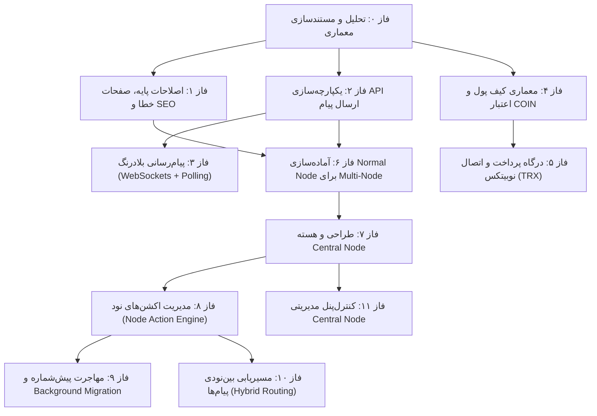

# نقشه راه جامع توسعه پلتفرم GetNumber (Development Roadmap)
### Enterprise Multi-Node Virtual Number & Messaging Infrastructure

> **وضعیت کلی:** فاز ۰ تکمیل شد (تحلیل و مستندسازی) | فازهای ۱ تا ۱۱ آماده اجرا  
> **آخرین به‌روزرسانی:** اکتبر ۲۰۲۶  
> **مخزن مرجع نود عادی (Normal Node):** [https://github.com/shanaqisaeed/GetNumber](https://github.com/shanaqisaeed/GetNumber)

---

## ۱. اصول و قواعد راهبردی توسعه (Guiding Principles)

1. **حفظ پایداری و سازگاری عقروعقب (Backward Compatibility):** هیچ قابلیت عملیاتی موجود نباید بدون دلیل فنی معتبر بازنویسی یا حذف شود.
2. **عدم تخریب و حفظ داده‌های عملیاتی:** داده‌های کاربران، شماره‌های واگذارشده، لاگ‌های ممیزی و پیام‌ها باید بدون دست‌خوردگی باقی بمانند.
3. **تغییرات دیتابیس صرفاً از طریق مایگریشن‌های استاندارد:** ساختارهای پایگاه داده بدون انحصار به درایور خاص طراحی و اعمال می‌شوند.
4. **دقت اتمیک در مبادلات مالی:** تمام تغییرات موجودی کیف پول و تخصیص شماره‌ها با تراکنش‌های ایزوله دیتابیس، قفل‌های سطری بدبینانه (`Pessimistic Row Lock`) و دفترکل تغییرناپذیر (`Immutable Ledger`) پیاده‌سازی می‌شوند.
5. **جداسازی کامل Normal Node و Central Node:** نود عادی هرگز وظایف هسته مرکزی (نظیر تخصیص جهانی پیش‌شماره یا صدور هویت شبکه) را اجرا نمی‌کند و در صورت قطع ارتباط با سرور مرکزی به شکل مستقل و آفلاین به کار خود ادامه می‌دهد.
6. **اجرای گام‌به‌گام همراه با آزمون و تأیید صریح:** پایان هر فاز شامل اجرای کامل تست‌ها، گزارش رسمی و توقف جهت اخذ تأیید صریح کاربر است.

---

## ۲. نمای کلی فازها و ماتریس وابستگی (Phases & Dependency Matrix)

---

## ۳. شرح تفصیلی فازهای توسعه (Detailed Phase Breakdown)

### فاز ۰: بررسی و مستندسازی پروژه فعلی (Discovery & Baseline Documentation)
- [x] استخراج ساختار کامل مخزن و بررسی روابط مدل‌ها
- [x] شناسایی تمام مسیرهای وب و REST API
- [x] اعتبارسنجی ۱۸۸ تست موجود (همه پاس‌شده)
- [x] تحلیل سیستم صف، اسکجولر و کارهای زمان‌بندی‌شده
- [x] استخراج پیش‌شماره‌های هاردکدشده در کد و قالب‌های کاربری
- [x] تدوین اسناد مرجع `DEVELOPMENT_ROADMAP.md` و `ARCHITECTURE.md`
- **وضعیت:** `COMPLETED`

---

### فاز ۱: اصلاحات پایه، صفحات سیستم و SEO (Foundation & System Pages)
- **اهداف:**
  - ایجاد صفحات خطای استاندارد متناسب با تم Vue/Inertia (400, 401, 403, 404, 405, 408, 419, 422, 429, 500, 502, 503, 504, 505) بدون افشای Stack Trace یا داده‌های حساس.
  - مدیریت یکپارچه و داینامیک عنوان صفحات (`<title>` استاندارد و تفکیک‌شده برای بخش‌های عمومی و داشبورد).
  - پیاده‌سازی متاتگ‌های سئو، Open Graph، Twitter Cards، Canonical URLs، `robots.txt` و `sitemap.xml`.
  - تنظیم قطعی `APP_DEBUG=false` در فایل `.env.example`.
- **وابستگی‌ها:** فاز ۰
- **ریسک‌ها:** تغییرات ساختار پوسته نباید تداخل بصری با کامپوننت‌های دارک‌مود یا RTL ایجاد کند.
- **وضعیت:** `COMPLETED`

---

### فاز ۲: یکپارچه‌سازی API ارسال پیام (Unified Messaging API)
- **اهداف:**
  - ادغام مسیرهای متفرق ارسال پیامک در یک Endpoint واحد و قدرتمند: `POST /api/v1/messages`.
  - پشتیبانی یکپارچه از ارسال تکی و گروهی، اعتبارسنجی مقاصد و حفظ Idempotency.
  - حفظ سازگاری عقروعقب کامل با Endpoints قدیمی (`/messages/send` و `/api/v1/messages/inbound`) از طریق Adapter.
  - بدون کسر هزینه Coin در این مرحله برای ارسال‌های API.
- **وابستگی‌ها:** فاز ۰
- **ریسک‌ها:** عدم شکستن کلاینت‌های موجود یا تست‌های وب‌هوک.
- **وضعیت:** `COMPLETED`

---

### فاز ۳: دریافت پیام به‌صورت Real-Time (Real-Time Messaging Engine)
- **اهداف:**
  - راه‌اندازی ارتباط دوسویه زنده برای نمایش فوری پیام‌های دریافتی بدون نیاز به Refresh دستی صفحه.
  - معماری ترکیبی: استفاده از Laravel Reverb / WebSockets در صورت دسترسی به همراه مکانیزم فال‌بک خودکار به Polling هوشمند.
  - پایش وضعیت اتصال کلاینت، اتصال مجدد خودکار (Reconnection) و خاموشی در تب‌های پس‌زمینه (Page Visibility API).
  - جلوگیری قطعی از دریافت پیام تکراری و به‌روزرسانی شمارنده خوانده‌نشده‌ها.
- **وابستگی‌ها:** فاز ۲
- **ریسک‌ها:** شرایط شبکه‌های اینترانت و پروکسی که ممکن است پورت‌های WebSocket را مسدود کنند.
- **وضعیت:** `PENDING`

---

### فاز ۴: معماری کیف پول و اعتبار Coin (Wallet & Ledger Architecture)
- **اهداف:**
  - ایجاد واحد مالی `COIN` با محاسبات اعشاری دقیق (`DECIMAL(18, 4)`) و نرخ پایه اولیه `1 TRX = 1 COIN`.
  - ایجاد دفترکل مالی تراکنش‌ها (`wallets` و `wallet_transactions`) با انواع `DEPOSIT`, `NUMBER_PURCHASE`, `ADMIN_CREDIT`, `ADMIN_DEBIT`, `REFUND`, `REVERSAL`.
  - منطق خرید اتمیک شماره مجازی به قیمت اولیه `1 COIN` با مکانیزم بازگشت وجه خودکار (`Refund`) در صورت بروز خطا در فرآیند تخصیص.
  - رابط کاربری داشبورد کیف پول، تاریخچه گردش حساب و پنل ممیزی مالی برای مدیران ارشد با ثبت Audit Log کامل.
- **وابستگی‌ها:** فاز ۰
- **ریسک‌ها:** بروز Race Condition در خریدهای همزمان؛ لزوم استفاده از `lockForUpdate` و قیدهای یکتایی پایگاه داده.
- **وضعیت:** `PENDING`

---

### فاز ۵: سیستم پرداخت و اتصال صرافی‌ها (Payment Gateway & Nobitex TRX)
- **اهداف:**
  - طراحی قرارداد مستقل `PaymentGatewayInterface` و ساختار ماژولار درگاه‌ها.
  - توسعه آداپتور رسمی صرافی نوبیتکس (`NobitexGateway`) جهت دریافت آدرس واریز TRX و استعلام TX Hash.
  - ثبت تراکنش‌های پرداخت، تأیید خودکار از طریق Cron Job دوره‌ای (هر ۱ دقیقه) و تأیید دستی با استعلام بلاک‌چین توسط ادمین.
  - جلوگیری اکید از استفاده مجدد از شناسه هش (`tx_hash` یکتا) و حملات ثبت مضاعف.
  - ساختار چند شبکه‌ای جهت آمادگی اتصال شبکه‌های آینده (مانند TON، BSC و غیره).
- **وابستگی‌ها:** فاز ۴
- **ریسک‌ها:** نوسانات شبکه صرافی و تأخیر در ثبت تأییدیه‌های بلاکچین؛ پیاده‌سازی استراتژی Retry با Exponential Backoff الزامی است.
- **وضعیت:** `PENDING`

---

### فاز ۶: آماده‌سازی Normal Node برای ساختار Multi-Node (Normal Node Decentralization)
- **اهداف:**
  - پیاده‌سازی سرویس `NodeAgent` در نود عادی برای اتصال Pull-Based امن (HTTPS) به نود مرکزی.
  - شناسایی و حذف کامل پیش‌شماره‌های هاردکدشده (`+85`) از مدل‌ها، اعتبارسنجی‌ها و فرانت‌اند.
  - پشتیبانی از محدوده پیش‌شماره‌های داخلی شبکه (`1` تا `999`).
  - تضمین استقلال کامل نود: در زمان قطع ارتباط با سرور مرکزی، تمام پیام‌رسانی‌های محلی، خریدها و مدیریت کاربران بدون اختلال ادامه یابد.
  - صف‌بندی محلی پیام‌های برون‌نودی تا زمان برقراری مجدد ارتباط با شبکه مرکزی.
- **وابستگی‌ها:** فاز ۱، فاز ۲
- **ریسک‌ها:** وابستگی ناخواسته کدهای محلی به پاسخ سرور مرکزی؛ باید کامپوننت‌های مستقل با استراتژی Offline-First توسعه یابند.
- **وضعیت:** `PENDING`

---

### فاز ۷: توسعه مستقل Central Node (Central Node Core Engine)
- **اهداف:**
  - طراحی هسته مستقل سرور مرکزی (Central Node) در یک مخزن/زیرساخت مجزا.
  - سیستم ثبت خودکار نودها (Self-Service Auto Registration) و صدور `Global Node ID` یکتا.
  - صدور و چرخش کلیدهای امنیتی (API Keys) و پشتیبانی از امضای دیجیتال نامتقارن (Public/Private Key).
  - مدیریت جامع و انحصاری پیش‌شماره‌ها (محدوده ۱ تا ۹۹۹)، ثبت رزرو زمان‌دار (پیش‌فرض ۱۵ دقیقه) و آزادسازی خودکار توسط Cron Job.
  - ارائه وب‌سرویس عمومی وضعیت پوشش شبکه (`GET /api/v1/coverage`).
- **وابستگی‌ها:** فاز ۶
- **ریسک‌ها:** رقابت همزمان نودها برای رزرو یک پیش‌شماره؛ لزوم اتمیک بودن رزرو با قید یکتایی در دیتابیس مرکزی.
- **وضعیت:** `PENDING`

---

### فاز ۸: مدیریت اکشن‌های نود (Node Action Management Engine)
- **اهداف:**
  - پیاده‌سازی صف پایدار و مقاوم (Durable Action Queue) بدون نیاز به آی‌پی یا دامنه ثابت برای نودها.
  - مدل ارتباطی Pull-Based: نودها دستورات را با `Lease` معتبر دریافت کرده و نتیجه یا خطای اجرا را بازمی‌گردانند.
  - تفکیک قطعی مهلت تحویل (`Delivery Lease`) از انقضای تجاری (`Business Expiration`).
  - جلوگیری از اجرای تکراری بر پایه تحویل حداقل یک‌بار (`At-Least-Once Delivery`) و شناسه یکتای Idempotency.
  - انواع اکشن‌های استاندارد: `SYNC_PREFIXES`, `MIGRATE_PREFIX`, `SYNC_ROUTES`, `ROTATE_API_KEY`, `REFRESH_CONFIG`, `HEALTH_CHECK`.
- **وابستگی‌ها:** فاز ۷
- **ریسک‌ها:** نودهای خاموش یا آفلاین طولانی‌مدت؛ دستورات نباید ناخواسته پاک شوند و اکشن‌های تاریخ‌گذشته باید با وضعیت مشخص سوخت شوند.
- **وضعیت:** `PENDING`

---

### فاز ۹: تغییر پیش‌شماره و مهاجرت پس‌زمینه (Background Prefix Migration)
- **اهداف:**
  - فرآیند اتوماتیک و امن تغییر پیش‌شماره یک نود (مانند تغییر پیشوند نود از ۸۵ به ۴۳) از طریق اکشن `MIGRATE_PREFIX`.
  - اجرای دسته‌ای (Batch Processing) در پس‌زمینه نود بدون توقف پاسخگویی سیستم.
  - حفظ تمام تاریخچه پیام‌ها، تراکنش‌ها، شماره‌ها (`Number ID`) و شناسه‌های کاربری.
  - به‌روزرسانی جدول مسیرهای ارتباطی در سایر نودهای شبکه و آزادسازی پیش‌شماره پیشین فقط پس از تأیید کامل سلامت مهاجرت.
- **وابستگی‌ها:** فاز ۸
- **ریسک‌ها:** خطای میانه راه در هنگام مهاجرت دسته‌ای؛ عملیات باید کامپوزیت و قابل Resume/Retry بدون ایجاد دیتای مضاعف باشد.
- **وضعیت:** `PENDING`

---

### فاز ۱۰: مسیریابی پیام بین نودها (Hybrid Inter-Node Routing)
- **اهداف:**
  - مسیریابی دوگانه (Hybrid Routing): تلاش برای ارسال مستقیم همتا‌به‌همتا (P2P Direct HTTPS) در صورت در دسترس بودن، و هدایت از طریق سرور مرکزی (Central Relay) در شرایط خاص یا فایروال نود.
  - اعتبارسنجی نود مبدأ، بررسی مجوزهای مالکیت شماره فرستنده و جلوگیری از جعل سرشماره (`Source Spoofing Prevention`).
  - امضای دیجیتال درخواست‌ها و محافظت در برابر Replay Attack با استفاده از Timestamp و Nonce.
  - صف‌بندی هوشمند پیام‌ها در شرایط آفلاین بودن نود مقصد با اعمال سیاست ماندگاری زمان‌دار.
- **وابستگی‌ها:** فاز ۸، فاز ۹
- **ریسک‌ها:** جعل پیام یا حملات دیداس روی گیت‌وی مستقیم نودها؛ کنترل با Rate Limiter و اعتبارسنجی امضای دیجیتال.
- **وضعیت:** `PENDING`

---

### فاز ۱۱: کنترل‌پنل مدیریت Central Node (Central Node Administration Suite)
- **اهداف:**
  - پنل مدیریتی مستقل جهت نظارت سراسری بر شبکه نودها و وضعیت آنلاین/آفلاین آن‌ها.
  - مدیریت کلان پیش‌شماره‌ها (تخصیص، رزرو، تعلیق، سلب مالکیت، قرنطینه اضطراری).
  - ثبت دستی و نظارت زنده بر صف اکشن‌ها، مشاهده لاگ‌ها، خطاها و پیشرفت عملیات (`Progress Monitoring`).
  - پیکربندی سیاست‌های امنیتی و کنترل ترافیک (سقف ترافیک نودها، بلک‌لیست، اعمال محدودیت‌های ارتباطی).
  - گزارش‌های ممیزی امنیتی، وقایع شبکه و تحلیل آماری تراکنش‌ها و پیام‌های ترانزیت.
- **وابستگی‌ها:** فاز ۷، فاز ۸، فاز ۱۰
- **ریسک‌ها:** دسترسی غیرمجاز به کنترل مرکزی؛ احراز هویت دوعاملی، محدودیت آی‌پی و ممیزی سخت‌گیرانه تمام اکشن‌ها الزامی است.
- **وضعیت:** `PENDING`

---

## ۴. جدول وضعیت لحظه‌ای فازها (Status Tracker)

| فاز | عنوان فاز | وابستگی | وضعیت | آزمون‌های هدف |
| :---: | :--- | :---: | :---: | :--- |
| **Phase 0** | بررسی، تحلیل و مستندسازی پایه | - | **تکمیل شد (COMPLETED)** | ۱۸۸ آزمون پاس‌شده موجود |
| **Phase 1** | صفحات خطای استاندارد، عنوان صفحات، SEO و پیکربندی | فاز ۰ | **تکمیل شد (COMPLETED)** | ۱۹۵ آزمون پاس‌شده (۱۰۶۱ Assertion) |
| **Phase 2** | یکپارچه‌سازی وب‌سرویس ارسال پیام (`/api/v1/messages`) | فاز ۰ | **تکمیل شد (COMPLETED)** | ۲۰۱ آزمون پاس‌شده (۱۰۷۹ Assertion) |
| **Phase 3** | دریافت بلادرنگ پیام‌ها (WebSockets + Polling) | فاز ۲ | در انتظار شروع | تست‌های اتصال، پیام‌های همزمان، فال‌بک |
| **Phase 4** | کیف پول، تراکنش‌های اتمیک و اعتبار مالی COIN | فاز ۰ | در انتظار شروع | آزمون‌های دفترکل، تست Concurrency و خرید شماره |
| **Phase 5** | درگاه پرداخت، صرافی نوبیتکس (TRX) و کرون تأیید | فاز ۴ | در انتظار شروع | تست‌های استعلام هش، رد تراکنش تکراری، شارژ خودکار |
| **Phase 6** | آماده‌سازی نود عادی، NodeAgent و حذف پیشوندهای ثابت | فاز ۱ و ۲ | در انتظار شروع | آزمون کارکرد آفلاین نود، پیشوندهای داینامیک ۱-۹۹۹ |
| **Phase 7** | هسته مستقل Central Node، ثبت خودکار و رزرو پیشوند | فاز ۶ | در انتظار شروع | تست ثبت همزمان، کلیدهای امنیتی، انقضای رزرو |
| **Phase 8** | موتور مدیریت اکشن‌ها (Durable Pull-Based Action Queue) | فاز ۷ | در انتظار شروع | تست Lease، انقضای تجاری، دریافت و تایید اکشن |
| **Phase 9** | مهاجرت پیش‌شماره نود در پس‌زمینه (Background Migration) | فاز ۸ | در انتظار شروع | آزمون یکپارچگی رکوردها در حین تغییر پیش‌شماره |
| **Phase 10** | مسیریابی پیام بین نودها (Hybrid Routing & Security) | فاز ۸ و ۹ | در انتظار شروع | تست ارسال مستقیم، رله مرکزی، جلوگیری از Spoofing |
| **Phase 11** | داشبورد مدیریت و رصد شبکه سرور مرکزی | فاز ۷، ۸ و ۱۰ | در انتظار شروع | آزمون‌های ممیزی، تغییر مالکیت، مدیریت سیاست‌ها |

