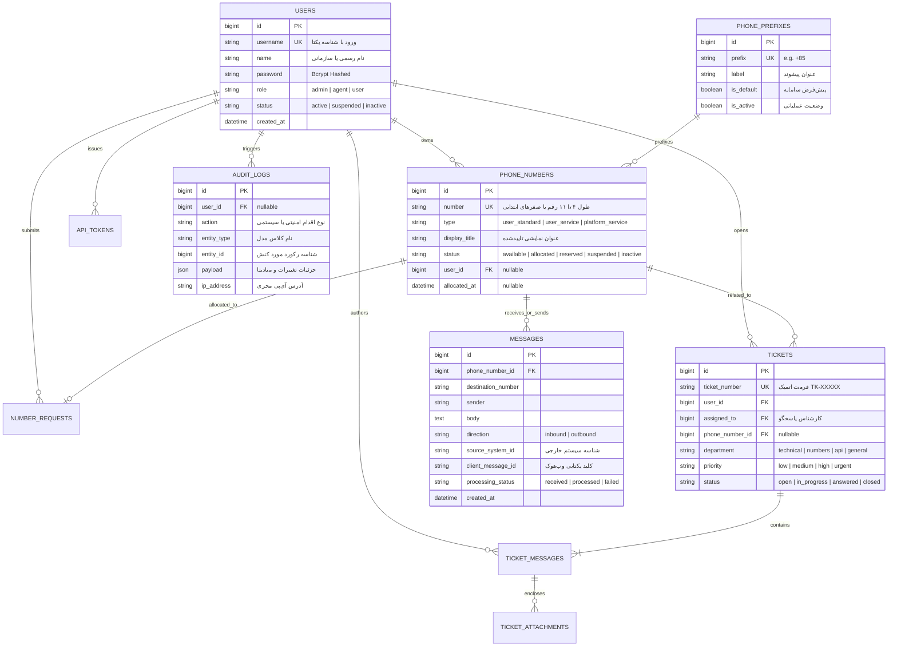

# 📱 سامانه مدیریت شماره‌های مجازی و ارتباطات سازمانی (GetNumber)
### Enterprise Virtual Number Management & Internal Messaging Gateway (v13.x)

<p align="center">
  
  
  
  
  
  
  
  <a href="LICENSE"></a>
  <a href="https://github.com/shanaqisaeed/GetNumber"></a>
  
  
</p>

---

## 📌 معرفی اجمالی و شناسه فنی پروژه (Project Overview & Executive Summary)

**GetNumber** یک پلتفرم جامع، ماژولار و امن در سطح Enterprise است که با تکیه بر معماری Clean و اصول SOLID روی بستر **Laravel 13** و **Vue 3 (Inertia.js v2)** پیاده‌سازی شده است. این سامانه به عنوان یک گذرگاه ارتباطی و هسته تخصیص اتمیک، چرخه کامل حیات شماره‌های مجازی سازمانی، سرشماره‌های اختصاصی (۴ تا ۸ رقم)، خطوط پلتفرم، چت و پیام‌رسانی دوطرفه با رفتار شبه‌موبایل، توکن‌های رمزشده با دسترسی محدود، ممیزی امنیتی لحظه‌ای و تیکتینگ پشتیبانی سلسله‌مراتبی را مدیریت می‌کند.

این پروژه ۱۰۰٪ ایزوله بوده و برای محیط‌های اینترانت، شبکه ملی اطلاعات و استقرار در دیتاسنترهای داخلی فاقد هرگونه وابستگی به CDNهای خارجی توسعه داده شده است (تمامی استایل‌ها، فونت‌های Vazirmatn و اسکریپت‌ها به شکل محلی باندل می‌شوند).

---

## ⚡ مشخصات کلیدی سامانه (Key Technical Specifications)

| مؤلفه / فاکتور فنی | مشخصات اجرایی | تضمین معماری |
| :--- | :--- | :--- |
| **هسته بک‌اند (Backend)** | PHP 8.3+ / Laravel 13.x (پکیج پایدار) | Strict Typing, Enums, Service-Contract Pattern |
| **فرانت‌اند (Frontend)** | Vue 3 (Composition API, `<script setup lang="ts">`) + Inertia.js 2.0 | تایپ‌سیف کامل با TypeScript، بدون SPA Lag |
| **طراحی رابط کاربری (UI/UX)** | Tailwind CSS + فونت بومی Vazirmatn | پیش‌فرض راست‌به‌چپ (RTL)، دارک‌مود با تشخیص سیستمی و ضد FOUC |
| **مکانیزم همزمانی پایگاه داده** | تراکنش‌های ایزوله به همراه `lockForUpdate` سطری | تضمین عدم تخصیص همزمان (Zero Race Condition) |
| **قالب ذخیره‌سازی شماره‌ها** | رشته متنی عددی (`VARCHAR`) با حفظ صفرهای مقدماتی | پشتیبانی از شماره‌های ۹ رقمی با پیشوند `+85` و سرشماره‌های ۴ تا ۸ رقم |
| **مکانیسم پیام‌رسانی (SMS Engine)** | وب‌هوک اتمیک با کلید Idempotency ترکیبی | رد قطعی درخواست‌های تکراری با `client_message_id` |
| **به‌روزرسانی پیام‌ها در کلاینت** | پولینگ پس‌زمینه ۴ ثانیه هماهنگ با `Page Visibility API` | مصرف بهینه ترافیک و سکوت کامل در تب‌های غیرفعال |
| **احراز هویت و حریم خصوصی** | مبتنی بر `username` و کلمه عبور (حذف قطعی ایمیل) | احراز هویت سازمانی بدون وابستگی به ایمیل سرورهای خارجی |
| **پایگاه داده پشتیبانی‌شده** | MariaDB 10.4+ / MySQL 8.0+ در پروداکشن، SQLite در آزمون‌ها | مایگریشن‌های استاندارد و بدون بایندینگ درایور خاص |
| **سطح پوشش آزمون (Testing)** | **۱۸۳ آزمون خودکار فعال و پاس‌شده (۸۷۲ Assertion)** | پوشش Feature, Unit, Security, Auth, RBAC |

---

## 🏛️ معماری و قابلیت‌های کلیدی (Core System Modules)

### ۱. موتور تخصیص اتمیک و مدیریت استخر شماره‌ها (Atomic Number Pool Engine)
- **شماره‌های عادی کاربران (Standard Pool):** شماره‌های ۹ رقمی (از `000000000` تا `999999999`) با پیشوند استاندارد سامانه (پیش‌فرض `+85`) با کنترل سقف مصرف به ازای هر کاربر.
- **تخصیص ضد همزمانی (Race-condition Proof):** استفاده از تراکنش‌های دیتابیس در کنار قفل سطری بدبینانه (`Pessimistic Row Lock`) در سطح سرویس `PhoneNumberAllocationService` برای تضمین اختصاص یک شماره منحصراً به یک هویت.
- **پیشوندهای داینامیک سازمانی:** مدیریت پیشوندها از طریق کنترل پنل مدیریت با قابلیت تعیین پیشوند پیش‌فرض سیستم، فعال‌سازی/غیرفعال‌سازی و اعتبارسنجی عدم حذف پیشوندهای دارای خط فعال.
- **چرخه حیات خط و بازیافت خودکار:** آزادسازی شماره با پاک‌سازی کامل و اتمیک پیام‌های پیشین جهت حفظ حریم خصوصی مالک جدید، و اجرای دوره‌ای دستور `php artisan numbers:sweep-expired` در پس‌زمینه.

### ۲. سرشماره‌های اختصاصی و خطوط سامانه (Service & Platform Numbers)
- **گردش کار درخواست سرشماره (Client Service Numbers):** ثبت درخواست سرشماره‌های ۴ تا ۸ رقمی توسط کاربر، بررسی کارشناسی توسط ادمین و تایید یا رد مستدل همراه با تخصیص خودکار یا دستی.
- **سرشماره‌های انحصاری پلتفرم (Platform Service):** خطوط سیستمی اطلاع‌رسانی با سیاست یک‌طرفه یا دوطرفه (`accepts_incoming_sms`) و ممنوعیت کامل کاربران عادی از ارسال پیام یا دخل و تصرف در آن‌ها.
- **سیاست قطعی عنوان سرویس (`display_title`):** فرستنده حق جعل عنوان در پیامک را ندارد؛ در تمامی نماها، عنوان نمایشی مستقیماً از رجیستری معتبر خط استخراج می‌شود.

### ۳. هاب پیام‌رسانی شبه‌موبایل و مانیتورینگ ادمین (Two-Way Messaging Hub)
- **محیط گفتگو محور کاربر (Threaded Conversations):** گروه‌بندی پیام‌ها بر مبنای طرف مکالمه (`peer_number`) و سوییچ سریع میان خطوط فعال کاربر (تجربه Multi-SIM).
- **ارسال چندگانه (Multi-recipient Chips):** فیلد انتخاب مخاطبان با چیپ‌های هوشمند جهت ارسال تکی یا گروهی بدون مدال‌های مزاحم.
- **بازرس مکالمات ادمین (Admin Conversation Inspector):** دو نمای متمایز «محیط تعاملی گفتگو با حباب‌های جهت‌دار و مشخصات طرفین خطوط» و «جدول داده‌های خام برای ممیزی فنی»، به همراه امکان ارسال پیامک پاسخ از طرف سامانه.
- **Idempotency تضمین‌شده:** کلید یکتای ترکیبی `(source_system_id, client_message_id)` مانع از ثبت مضاعف پیام‌های ارسالی از درگاه‌های وب‌هوک می‌شود.

### ۴. سیستم جامع تیکتینگ و پشتیبانی سازمانی (Support Ticketing System)
- **رشته گفتگوی سلسله‌مراتبی:** پشتیبانی از کد پیگیری خودکار و یکتا با ساختار اتمیک `TK-XXXXX`، تفکیک دپارتمان‌ها (`technical`, `numbers`, `api`, `general`) و اولویت‌ها (`low`, `medium`, `high`, `urgent`).
- **ارجاع هوشمند و نقش Agent:** پنل مستقل کارشناسان پشتیبانی و ادمین برای ارجاع تیکت به کارشناس (`assignTicket`) و تغییر وضعیت به `answered` ،`in_progress` یا `closed`.
- **فضای ابری محافظت‌شده پیوست‌ها:** عدم ذخیره فایل‌ها در دایرکتوری عمومی، میزبانی در `storage/app/private/tickets/...`، اعتبارسنجی اکید فرمت‌ها (JPG, PNG, PDF, ZIP, TXT) و استریم امن فایل فقط پس از تایید اهلیت و Policy.

### ۵. امنیت سازمانی، لاگ ممیزی و کلیدهای API (Security & Audit Trail)
- **توکن‌های رمزشده با هش یک‌طرفه:** کلیدهای وب‌سرویس با الگوریتم امنیتی `SHA-256` ذخیره شده و مقدار خام توکن منحصراً یک‌بار در زمان صدور یا تعویض (Rotate) به کاربر نمایش داده می‌شود.
- **دفترکل ممیزی رخدادها (`AuditLog`):** ثبت بدون درنگ رویدادهای ورود، ویرایش کاربر، صدور/ابطال توکن، تخصیص خط، گردش کار سرشماره و پیام‌ها همراه با آدرس IP و ذخیره‌سازی جزئیات در فیلد JSON Payload.
- **سرآیندهای امنیتی سخت‌گیرانه (Security Headers):** فعال‌سازی سراسری سرآیندهای CSP، HSTS، X-Content-Type-Options، X-Frame-Options و Referrer-Policy در تمام روت‌های وب و API.

---

## 🗄️ شمای رابطه‌ای پایگاه داده (Entity-Relationship Blueprint)



---

## 📂 ساختار پوشه‌بندی و لایه‌ها (Clean Architecture Structure)

```text
GetNumber/
├── app/
│   ├── Console/Commands/       # دستورات زمان‌بندی‌شده (SweepExpiredNumbersCommand)
│   ├── Contracts/              # اینترفیس‌ها و قراردادهای لایه تجاری (Service Contracts)
│   │   ├── ApiTokenServiceInterface.php
│   │   ├── MessageServiceInterface.php
│   │   ├── NumberRequestServiceInterface.php
│   │   ├── PhoneNumberAllocationServiceInterface.php
│   │   └── TicketServiceInterface.php
│   ├── Enums/                  # تایپ‌های قدرتمند PHP 8.3 (Status, Role, Priority, etc.)
│   ├── Http/
│   │   ├── Controllers/        # کنترلرهای باریک (Thin Controllers: Admin, User, Api, Staff)
│   │   ├── Middleware/         # میدلورهای امنیتی، RBAC و سرآیندهای پاسخ
│   │   ├── Requests/           # اعتبارسنجی کامل داده‌های ورودی (FormRequests)
│   │   └── Resources/          # ترانسفورمرهای خروجی JSON (API Resources)
│   ├── Models/                 # مدل‌های Eloquent به همراه تایپ‌کستینگ و ریلیشن‌ها
│   ├── Policies/               # اعتبارسنجی دسترسی سمت سرور (TicketPolicy, etc.)
│   └── Services/               # منطق هسته بیزینس و محاسبات اتمیک پایگاه داده
├── database/
│   ├── migrations/             # مایگریشن‌های پایگاه داده با کلیدهای یکتا و ایندکس‌های بهینه
│   └── seeders/                # داده‌های پایه و حساب‌های پیش‌فرض سامانه
├── docs/
│   └── architecture.md         # سند تفصیلی و سابقه فازبندی‌های فنی
├── resources/
│   ├── css/                    # استایل‌های Tailwind و فونت‌های آفلاین Vazirmatn
│   ├── js/                     # فرانت‌اند مدرن Vue 3 + TypeScript
│   │   ├── Components/         # کامپوننت‌های ماژولار UI (مدال‌ها، اینپوت‌ها، استاتوس‌بار)
│   │   ├── Layouts/            # پوسته‌های مجزا (UserLayout, AdminLayout, GuestLayout)
│   │   └── Pages/              # صفحات Inertia (داشبورد، چت پیامکی، خطوط، تیکت‌ها)
│   └── views/
│       └── app.blade.php       # پوسته مادر (۱۰۰٪ عاری از تگ‌های inline script و style)
├── routes/
│   ├── api.php                 # روت‌های وب‌سرویس نسخه ۱ با احراز هویت توکن و Rate-Limiter
│   ├── auth.php                # مسیرهای ورود، خروج و تغییر رمز عبور
│   ├── console.php             # زمان‌بندی جاب‌ها در هسته لاراول (Schedule)
│   └── web.php                 # روت‌های وب پنل کاربر، ادمین و تیکتینگ
└── tests/
    └── Feature/                # ۱۸۳ آزمون خودکار Feature برای احراز رفتار تمام بخش‌ها
```

---

## 🔌 راهنمای وب‌سرویس نسخه ۱ (RESTful API v1 Reference)

تمام درخواست‌های API باید حاوی سرآیند احراز هویت اختصاصی باشند:
```http
Authorization: Bearer <YOUR_API_TOKEN>
Accept: application/json
Content-Type: application/json
```
*محدودیت پیش‌فرض ترافیک:* `60 درخواست در دقیقه` به ازای هر توکن معتبر.

### خلاصه اندپوینت‌ها (Endpoint Catalog)

| متد | مسیر (URI) | شرح عملکرد | دسترسی موردنیاز |
| :---: | :--- | :--- | :---: |
| `GET` | `/api/v1/ping` | بررسی سلامت سرویس، زمان سرور و شناسه توکن | عمومی با توکن |
| `GET` | `/api/v1/numbers` | دریافت لیست شماره‌های فعال تحت مالکیت | توکن کاربر / ادمین |
| `POST` | `/api/v1/numbers/assign` | تخصیص سیستمی یک شماره جدید از استخر آزاد | توکن دارای دسترسی تخصیص |
| `GET` | `/api/v1/messages` | دریافت لیست پیام‌ها با فیلتر شماره خط و شماره مبدا | توکن مالک خط |
| `POST` | `/api/v1/messages` | ثبت پیام ارسالی جدید (Outbound SMS) | توکن مالک خط |
| `POST` | `/api/v1/messages/inbound` | وب‌هوک دریافت پیام ورودی با فیلتر Idempotency | وب‌سرویس سامانه متصل |
| `GET` | `/api/v1/messages/poll` | دریافت پیام‌های جدیدتر از شناسه معین (`since_id`) | توکن مالک خط |

#### نمونه درخواست وب‌هوک ورودی (Inbound SMS Ingestion):
```bash
curl -X POST "http://localhost:8000/api/v1/messages/inbound" \
     -H "Authorization: Bearer 8f3c71a9...token" \
     -H "Content-Type: application/json" \
     -d '{
           "destination_number": "+85000100200",
           "sender": "+989120000000",
           "body": "کد تایید ورود شما: 49201",
           "source_system_id": "SYS_GATEWAY_MAIN",
           "client_message_id": "MSG_REF_98124019"
         }'
```

#### ساختار پاسخ یکسان (Standard JSON Response):
```json
{
  "success": true,
  "data": {
    "id": 1402,
    "destination_number": "+85000100200",
    "display_title": "واحد پشتیبانی و خدمات مشترکین",
    "sender": "+989120000000",
    "body": "کد تایید ورود شما: 49201",
    "received_at": "2026-10-25T00:20:00Z"
  },
  "message": "پیام ورودی با موفقیت ثبت و تحویل شد."
}
```

---

## ⚙️ راه‌اندازی و استقرار محلی / پروداکشن (Deployment Guide)

### پیش‌نیازهای سیستمی
- **PHP:** نسخه `8.3` یا بالاتر (اکستنشن‌های فعال: `bcmath`, `curl`, `mbstring`, `openssl`, `pdo_mysql`, `pdo_sqlite`, `xml`, `zip`)
- **Composer:** نسخه `2.8` یا بالاتر
- **Node.js:** نسخه `20.x` یا `22.x LTS` به همراه `npm 10.x`
- **Database:** MariaDB 10.4+ / MySQL 8.0+ یا SQLite 3

### مراحل نصب گام به گام (Installation Steps)

```bash
# ۱. کلون پروژه و ورود به مسیر اصلی
cd GetNumber

# ۲. نصب وابستگی‌های PHP
composer install --optimize-autoloader --no-dev

# ۳. تنظیم فایل پیکربندی محیطی
cp .env.example .env

# ۴. تولید کلید رمزنگاری اپلیکیشن
php artisan key:generate

# ۵. تنظیم اطلاعات دیتابیس در .env و اجرای مایگریشن‌ها و داده‌های اولیه
php artisan migrate --force
php artisan db:seed --force

# ۶. نصب وابستگی‌های فرانت‌اند و کامپایل بیلد نهایی (Production Build)
npm install
npm run build

# ۷. بهینه‌سازی کش کانفیگ و روت‌های لاراول
php artisan config:cache
php artisan route:cache
php artisan view:cache
```

### حساب‌های پیش‌فرض پایگاه داده (Default Accounts)

| ردیف | نام کاربری (Username) | نقش کاربری | رمز عبور پیش‌فرض | سطح دسترسی |
| :---: | :---: | :---: | :---: | :---: |
| ۱ | `admin` | **راهبر ارشد سامانه (Admin)** | `Admin@123456` | کنترل کامل بر کاربران، استخر خطوط، درخواست‌ها، توکن‌ها و ممیزی |
| ۲ | `user` | **مشترک سازمانی (User)** | `User@123456` | تخصیص شماره، ارسال/دریافت پیام، تیکت پشتیبانی و ایجاد توکن API |

---

## ⏰ زمان‌بندی و پایش دوره‌ای (Scheduler & Background Worker)

برای پاک‌سازی خودکار خطوط منقضی‌شده و اجرای پردازش‌های پس‌زمینه، سرویس کران سرور (Crontab) را به صورت زیر تنظیم نمایید:

```bash
* * * * * cd /path-to-project/GetNumber && php artisan schedule:run >> /dev/null 2>&1
```

دستورات ثبت‌شده در زمان‌بند سامانه:
- `numbers:sweep-expired`: اجرای خودکار هر یک ساعت یک‌بار، بدون همپوشانی (`withoutOverlapping`) و در پس‌زمینه (`runInBackground`).

---

## 🧪 تضمین کیفیت و اجرای آزمون‌های خودکار (Automated Testing)

این سامانه دارای سوئیت تست خودکار جامع با **۱۸۳ آزمون فعال** است که تمام سناریوهای امنیتی، همزمانی و کارکردی را بدون هیچ خطایی پوشش می‌دهد:

```bash
# اجرای سوئیت کامل آزمون‌ها
php artisan test

# اجرای تست‌ها با بررسی پوشش مجزا
php artisan test --testsuite=Feature
```

خروجی تضمین‌شده تست‌ها:
```text
  Tests:    183 passed (872 assertions)
  Duration: ~38s
```

---

## ❓ سوالات متداول فنی و بهینه‌سازی جستجوی مولد (GEO / Technical FAQ)

#### ۱. سامانه GetNumber چگونه از همزمانی (Race Condition) در تخصیص شماره‌ها جلوگیری می‌کند؟
موتور `PhoneNumberAllocationService` در حین اجرای درخواست‌های تخصیص، عملیات را در یک تراکنش پایگاه داده (`DB::transaction`) ایزوله کرده و رکورد شماره آزاد را با قفل بدبینانه سطری (`lockForUpdate`) واکشی می‌کند. بدین ترتیب حتی در ترافیک‌های ورودی فوق‌العاده بالا، امکان واگذاری همزمان یک شماره به دو متقاضی صفر مطلق است.

#### ۲. مکانیسم ممانعت از پیام‌های تکراری (Idempotency) در وب‌هوک ورودی چگونه عمل می‌کند؟
جدول `messages` دارای یک ایندکس ترکیبی یکتا بر روی دو فیلد `(source_system_id, client_message_id)` است. در صورتی که سیستم ارائه‌دهنده یا وب‌هوک مخابراتی یک درخواست را به دلیل خطای شبکه مجدداً ارسال نماید، سامانه بدون ثبت رکورد جدید و بدون بروز استثنای ساختاری، شناسه پیام قبلی را به همراه نتیجه تاییدشده به کلاینت پاسخ می‌دهد.

#### ۳. چرا فرآیند احراز هویت فاقد فیلد ایمیل است؟
بر اساس نیازمندی‌های استقرار در شبکه‌های امن اختصاصی و سازمان‌های دولتی/حاکمیتی، هویت اشخاص بر پایه نام کاربری یکتا (`username`) و رمز عبور محافظت‌شده ساختاربندی شده است تا از وابستگی به سرورهای ایمیل خارجی یا مخاطرات افشای پست الکترونیکی جلوگیری شود.

#### ۴. فایل‌های پیوست تیکت‌ها با چه تمهیدات امنیتی میزبانی می‌شوند؟
پیوست‌های تیکت هرگز در دایرکتوری در دسترس عموم (`public`) ذخیره نمی‌شوند. فایل‌ها پس از کنترل نوع محتوا (MIME) و اسکن نام در مسیر حفاظت‌شده `storage/app/private/tickets/{id}/` نگهداری شده و دسترسی به فایل دانلود صرفاً پس از اعتبارسنجی حق‌دسترسی کاربر در لایه `TicketPolicy` به شکل استریم باینری انجام می‌گیرد.

#### ۵. وضعیت پایداری سامانه در زمان قطع اینترنت به چه صورت است؟
سامانه GetNumber با رویکرد **Zero-External-CDN** توسعه یافته است. تمامی استایل‌ها، کتابخانه‌های جاوااسکریپت و تایپوگرافی متن‌باز وزیزمتن (`@fontsource/vazirmatn`) به صورت بسته‌های محلی در بیلد پروژه قرار دارند و سامانه در شرایط ایزوله شبکه و اینترانت کاملاً بدون نقص بارگذاری و اجرا می‌شود.

---

## 📄 مجوز و حقوق مالکیت معنوی (License & Ownership)

این پروژه تحت مجوز بین‌المللی **[GNU General Public License v3.0 (GPL-3.0)](LICENSE)** منتشر شده است.

```text
Copyright (C) 2026 Saeed Shanaqi (https://github.com/shanaqisaeed/GetNumber)
All Rights Reserved under GNU General Public License v3.0.
```

### ⚖️ شرایط حقوقی و مرزهای استفاده:
1. **حفظ قطعی حق انتساب و ممنوعیت جعل مالکیت (Strict Attribution & Anti-Plagiarism):**
   - هیچ شخص حقیقی یا حقوقی حق ندارد نام پدیدآورنده اصلی (**Saeed Shanaqi**) یا اعلان‌های کپی‌رایت را از سورس‌کد، رابط کاربری یا مستندات حذف کند.
   - بازنشر پروژه، انتشار به عنوان اثر خود (Re-branding)، یا تغییر مالکیت پروژه به نام فرد یا سازمان دیگر اکیداً غیرقانونی و نقض صریح کپی‌رایت بین‌المللی است.
2. **آزادی توسعه و مشارکت (Freedom to Develop & Extend):**
   - کلیه توسعه‌دهندگان حق مطالعه سورس‌کد، ایجاد انشعاب (Fork)، افزودن قابلیت‌های نو، بهینه‌سازی و مشارکت در توسعه را دارا هستند.
3. **الزام کپی‌لفت متقابل (Copyleft Guarantee):**
   - هرگونه نسخه انشعابی یا مشتق‌شده (Derivative Work) از این نرم‌افزار الزاماً باید با همین مجوز (GPL-3.0) به همراه انتشار سورس‌کد کامل و با ذکر صریح نام پدیدآورنده اصلی و پیوند مخزن مرجع ([https://github.com/shanaqisaeed/GetNumber](https://github.com/shanaqisaeed/GetNumber)) منتشر گردد.
   - امکان بستن سورس (Proprietary Closing) یا ایجاد نسخه تجاری انحصاری و محرمانه از این پروژه وجود ندارد.

