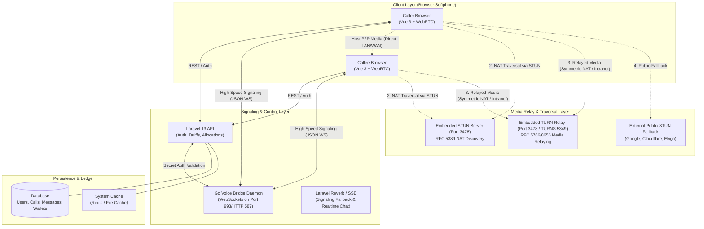
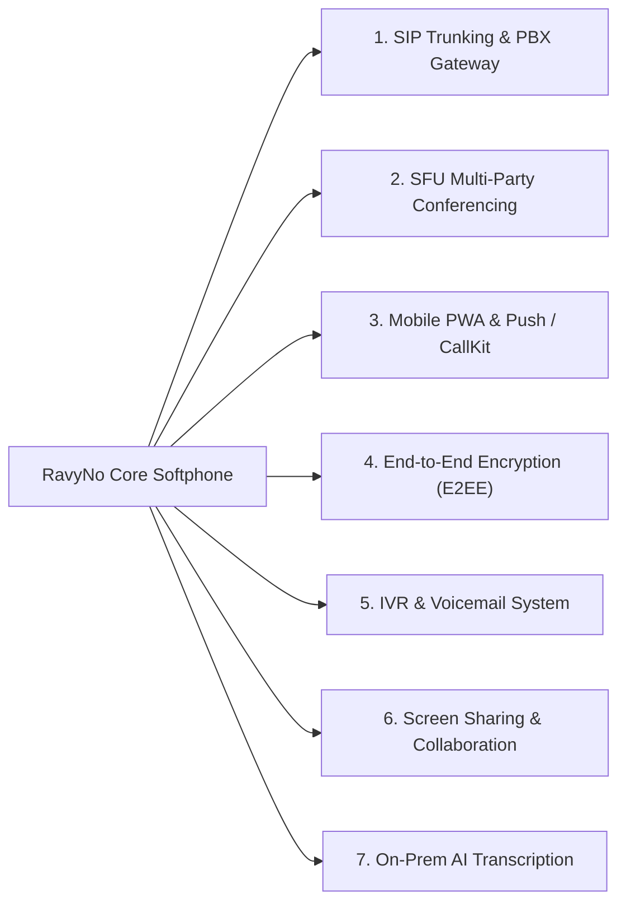
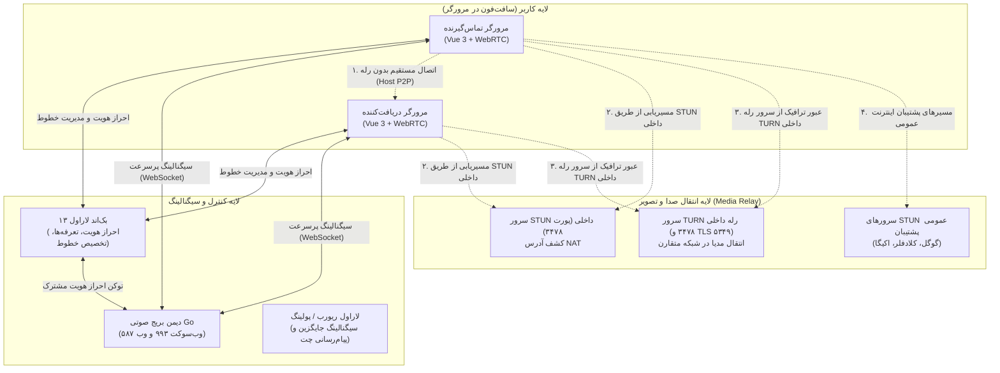
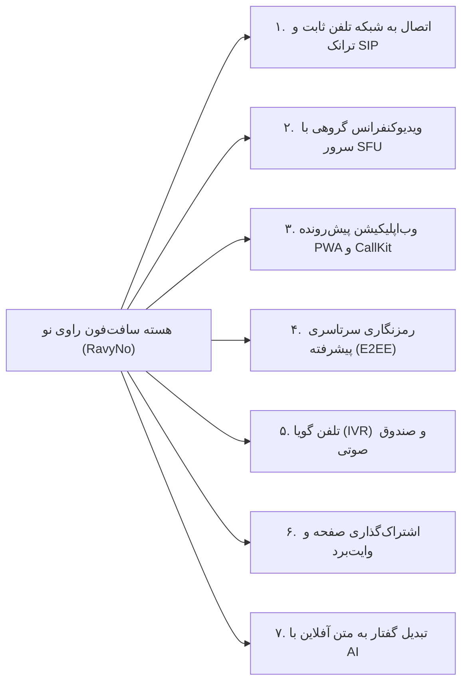

# 📞 RavyNo — Self-Hosted WebRTC Softphone, Resilient Voice/Video Calling & Unified Messaging Platform
### سافت‌فون اختصاصی، سامانه ارتباط زنده صوتی و تصویری WebRTC و درگاه ارتباطی مقاوم در شرایط اینترانت

<p align="center">
  <b>A production-grade, 100% self-hosted Softphone and real-time communication platform engineered for high survivability in restricted networks, featuring WebRTC audio/video calling, an in-house Go Voice Bridge with embedded STUN/TURN media relay, threaded messaging, and internal coin billing.</b>
</p>

<p align="center">
  <a href="#-english-documentation">🇬🇧 English Documentation</a> •
  <a href="#-مستندات-فارسی">🇮🇷 مستندات فارسی</a>
</p>

<p align="center">
  
  
  
  
  
  
  
  
  <a href="LICENSE"></a>
</p>

---

## 🌐 Language Switcher / انتخاب زبان

- [🇬🇧 English Documentation](#-english-documentation)
- [🇮🇷 مستندات و راهنمای جامع فارسی](#-مستندات-فارسی)

---

# 🇬🇧 English Documentation

## 📑 Table of Contents
1. [Project Reality & Purpose](#1-project-reality--purpose)
2. [Why Softphone & Why RavyNo? (Intranet Survival)](#2-why-softphone--why-ravy-no-intranet-survival)
3. [Architecture & System Design](#3-architecture--system-design)
4. [Core Features Breakdown](#4-core-features-breakdown)
   - [WebRTC Audio & Video Calling Engine](#41-webrtc-audio--video-calling-engine)
   - [Go Voice Bridge Daemon & Embedded Media Relay](#42-go-voice-bridge-daemon--embedded-media-relay)
   - [Smart STUN/TURN Multi-Tier Resiliency Matrix](#43-smart-stunturn-multi-tier-resiliency-matrix)
   - [Two-Way Threaded Messaging Hub](#44-two-way-threaded-messaging-hub)
   - [Billing, Tariffs & Wallet Ledger](#45-billing-tariffs--wallet-ledger)
   - [Data Privacy & Soft-Delete Engine](#46-data-privacy--soft-delete-engine)
5. [Developer Future Roadmap](#5-developer-future-roadmap)
6. [Installation & Deployment Guide](#6-installation--deployment-guide)
7. [Running the Go Voice Bridge Daemon](#7-running-the-go-voice-bridge-daemon)
8. [Automated Testing & Quality Assurance](#8-automated-testing--quality-assurance)
9. [License & Attribution](#9-license--attribution)

---

### 1. Project Reality & Purpose

**RavyNo** is an enterprise-grade, browser-native **Softphone** and real-time communication platform. It allows users to initiate and receive high-definition peer-to-peer (P2P) and relayed voice and video calls, exchange two-way threaded messages, manage virtual line identities, and handle usage billing via an internal coin ledger.

Unlike traditional commercial communication suites that depend on external SaaS platforms (Twilio, Zoom, Google Meet, WhatsApp) or centralized foreign cloud infrastructure, RavyNo is **100% self-hosted and on-premise ready**. It runs autonomously inside private corporate clouds, air-gapped banking networks, and national intranet infrastructures (e.g., Iran's National Information Network).

---

### 2. Why Softphone & Why RavyNo? (Intranet Survival)

In restricted network environments, international internet outages, or heavy protocol throttling:
- **Foreign SaaS & Cloud Services Fail:** Foreign VoIP providers, STUN/TURN resolvers (Google, Cloudflare), and push notification services become completely unreachable due to firewall blocks, DNS poisoning, or border packet filtering.
- **Port Throttling & Deep Packet Inspection (DPI):** Standard SIP ports (`5060/udp`) and common WebRTC relay ports are frequently inspected and throttled by ISPs.
- **Privacy & Compliance Constraints:** Financial institutions and sensitive organizations cannot route voice data or employee messages through third-party foreign servers.

**RavyNo serves as an independent lifeline:**
1. **Zero External CDN Dependencies:** All frontend assets, fonts (Vazirmatn), stylesheets, and scripts are bundled locally.
2. **Dedicated Go Voice Bridge:** Runs on low, stealthy, firewall-friendly ports (e.g., HTTP on `587`, WebSocket on `993`, or internal custom ports) to bypass port filtering and DPI.
3. **In-House Media Relay:** Embeds RFC 5389 (STUN) and RFC 5766/8656 (TURN) servers within the Go binary, allowing media relays to operate entirely inside the national network with ephemeral HMAC-SHA1 credentials.
4. **Resilient ICE Gathering:** In "Strict Offline Mode", external cloud STUN servers are purged automatically, eliminating DNS timeout delays and establishing local P2P or relayed connections within milliseconds.

---

### 3. Architecture & System Design



---

### 4. Core Features Breakdown

#### 4.1. WebRTC Audio & Video Calling Engine
- **Dual Dialpad Interface:**
  - **Standard 3x4 Numeric Dialpad:** For dialing standard line numbers (`+85`, `+98`, etc.) and short extensions (`1001`, `851`).
  - **Handle / ID Dialpad:** Direct peer-to-peer calling using unique usernames or custom handles (`@ceo`, `@support`).
- **Symmetrical & Responsive UI:**
  - Polished responsive dialer input with zero layout shift (CLS).
  - Suppression of native browser focus outlines and borders via scoped CSS.
  - Dedicated action buttons: single-character backspace (`⌫`) and clear-all (`پاک‌کردن`).
  - Quick contact picker modal directly integrated with user address book.
- **Audio & Video Quality Enhancements:**
  - **Opus In-Band FEC & DTX:** Custom SDP munging enables RFC 4566-compliant forward error correction and discontinuous transmission for high clarity on packet-lossy links.
  - **Live Noise Cancellation:** One-click toggle for active acoustic echo cancellation (AEC), noise suppression (NS), and automatic gain control (AGC) applied directly to active media tracks.
  - **Dynamic Multi-Camera Switching:** Seamless live switching between front/selfie (`facingMode: user`) and rear/environment (`facingMode: environment`) cameras on smartphones and desktops without dropping the call.
  - **Video Quality Controls:** On-the-fly resolution scaling (HD 720p, SD 480p, Low 360p) and true fullscreen immersive mode.

#### 4.2. Go Voice Bridge Daemon & Embedded Media Relay
- **Lightweight High-Concurrency Daemon:** Built with Go 1.22+, utilizing `pion/webrtc` and `pion/turn`.
- **Low-Port Stealth Operation:** Configurable to run on standard low ports (`587/tcp` for HTTP REST status, `993/tcp` for WebSocket signaling) to pass through strict firewalls that block high-numbered ports.
- **Security & Multiplexing:** Validates communication between Laravel and the daemon via a 32-character SHA-256 HMAC shared secret token (`.secret`).
- **In-Memory Session Manager:** Tracks active calls, call participants, connection states, and uptime with zero database overhead.

#### 4.3. Smart STUN/TURN Multi-Tier Resiliency Matrix
- **Tier 1 (Host Candidate):** Direct peer-to-peer media transmission when users reside on the same LAN or reachable IP subnet.
- **Tier 2 (Embedded Go STUN/TURN):** Local NAT discovery and media relaying via RFC 5389 / RFC 5766 on port `3478` (UDP/TCP) and secure TURNS on port `5349` (TLS).
- **Tier 3 (Ephemeral REST Credentials):** Generates short-lived dynamic TURN credentials (`username: <timestamp>:<user_id>`, `credential: base64(hmac-sha1)`) preventing relay theft while ensuring zero manual configuration for clients.
- **Tier 4 (Public STUN Matrix):** Integrated backup list of 50+ public STUN relays (Google, Cloudflare, Ekiga, Viagenie, 3CX) utilized when external internet connectivity is detected.
- **Strict Intranet / Offline Mode:** Disables all external cloud lookups when operating during internet blackouts to prevent client ICE gathering hangs.

#### 4.4. Two-Way Threaded Messaging Hub
- **Mobile-Style Chat Interface:** Messages grouped by contact/peer into responsive conversation threads.
- **Multi-Line SIM Switching:** Users holding multiple virtual lines can switch active sending lines seamlessly.
- **Real-Time Delivery & Read Status:** Live two-tick delivery indicators powered by WebSockets with automatic fallback to visibility-aware polling.
- **Soft-Delete with Bulk Actions:** Users can delete individual messages, bulk selections, or entire conversations from their view (`user_deleted_at`), while audit records are preserved for administrative oversight.

#### 4.5. Billing, Tariffs & Wallet Ledger
- **Granular Per-Minute Tariffs:** Evaluates whether a call is ID-to-ID (`id_voice_rate_per_minute`) or Number-to-Number (`voice_call_rate_per_minute` / prefix tariff).
- **Zero-Cost Transaction Prevention:** Free calls (rate 0.0000) strictly bypass wallet debits, preventing clutter and redundant zero-amount records in `wallet_transactions`.
- **Coin-Based Accounting:** All accounting is tracked in integer/decimal `COIN` units.
- **Cryptocurrency Top-Up Gateway:** Direct on-chain TRON (TRX/USDT) processing alongside Nobitex and Wallex exchange integrations with offline client-rendered QR codes.

#### 4.6. Data Privacy & Soft-Delete Engine
- User records for both calls and messages support soft-deletion (`user_deleted_at`).
- Complete historical retention remains accessible in the Admin Panel for compliance, anti-abuse investigations, and reporting.

---

### 5. Developer Future Roadmap

To expand RavyNo from an enterprise softphone into a comprehensive telecommunications suite, developers can introduce the following high-value architectural extensions:



#### 1. SIP Trunking & PBX Gateway Integration (Asterisk / FreePBX / Kamailio)
- **Goal:** Enable the RavyNo softphone to place and receive calls to and from traditional telecommunications networks (PSTN, mobile operators, and corporate SIP extensions).
- **Architecture:** Deploy a SIP-to-WebRTC gateway using **Kamailio** or an **Asterisk / FreePBX** instance with `chan_pjsip` and WSS (WebSocket Secure) transport.
- **Value:** Users can call physical landlines or mobile numbers directly from the browser softphone.

#### 2. SFU Multi-Party Conferencing (Group Audio & Video)
- **Goal:** Support group rooms, team meetings, and webinars with 10 to 100+ simultaneous participants.
- **Architecture:** Integrate a lightweight Selective Forwarding Unit (SFU) such as **LiveKit** or **mediasoup** (running alongside the Go bridge).
- **Value:** Replaces peer-to-peer full mesh (which saturates client upload bandwidth beyond 3 participants) with a centralized routing unit that forwards individual streams efficiently.

#### 3. Mobile PWA & Push Integration with Native CallKit
- **Goal:** Provide a native mobile calling experience on iOS and Android when the browser is minimized or the screen is locked.
- **Architecture:** Implement a Progressive Web App (PWA) with **Web Push API** and service workers, paired with a lightweight Capacitor wrapper utilizing iOS **CallKit** and Android **ConnectionService**.
- **Value:** Incoming calls wake up the device and show native incoming call UI (accept/reject) even when the user is not actively on the website.

#### 4. End-to-End Encryption (E2EE) with SFrame / MLS
- **Goal:** Guarantee zero-trust confidentiality for sensitive organizational audio, video, and text communication.
- **Architecture:** Implement WebRTC **Insertable Streams** with the **SFrame (RFC 9605)** standard or Messaging Layer Security (MLS) for key agreement.
- **Value:** Media frames are encrypted on the sender's client before reaching the WebRTC stack; intermediate relays (including the Go bridge daemon) have zero access to plaintext media.

#### 5. Interactive Voice Response (IVR) & Offline Voicemail
- **Goal:** Automated attendant menus (`Press 1 for Sales, Press 2 for Support`) and audio voicemail recording.
- **Architecture:** Server-side audio playback and DTMF tone detection (`RFC 4733 / RFC 2833`) on the voice bridge, storing audio recordings in private storage for authenticated playback.
- **Value:** Turns virtual numbers into complete corporate call centers.

#### 6. Screen Sharing & In-Call Annotation
- **Goal:** Enable remote technical support and interactive presentations directly inside active calls.
- **Architecture:** Leverage the browser's `navigator.mediaDevices.getDisplayMedia()` API to stream desktop displays alongside camera video, paired with a lightweight SVG canvas for live collaborative whiteboard drawing.

#### 7. On-Premises AI Voice Transcription & Meeting Minutes
- **Goal:** Automated real-time speech-to-text without sending sensitive audio data to external foreign clouds.
- **Architecture:** Connect audio streams to an on-premise **Whisper.cpp** or **Vosk** instance running locally on the server.
- **Value:** Automatic Persian and English call summaries, searchable transcripts, and compliance archiving 100% within the intranet.

---

### 6. Installation & Deployment Guide

#### Server Requirements
- **PHP:** `8.3+` (`bcmath`, `curl`, `mbstring`, `openssl`, `pdo_mysql` or `pdo_sqlite`, `sodium`, `xml`, `zip`)
- **Node.js:** `20.x` or `22.x LTS` & `npm 10.x+`
- **Go:** `1.22+` (only if compiling the Voice Bridge daemon from source)
- **Composer:** `2.8+`
- **Database:** SQLite 3, MariaDB 10.4+, or MySQL 8.0+

#### Quickstart Installation
```bash
# 1. Clone repository
git clone https://github.com/shanaqisaeed/RavyNo.git
cd RavyNo

# 2. Install PHP backend dependencies
composer install --optimize-autoloader

# 3. Environment configuration
cp .env.example .env
php artisan key:generate

# 4. Run database migrations & seed initial records
php artisan migrate --force
php artisan db:seed --force

# 5. Install frontend packages and compile production assets
npm install
npm run build

# 6. Start local development server
php artisan serve
```

---

### 7. Running the Go Voice Bridge Daemon

The Voice Bridge daemon resides in `services/voice-bridge`. It provides high-speed WebRTC signaling and media relay capabilities.

```bash
# 1. Navigate to voice-bridge directory
cd services/voice-bridge

# 2. Build the Go binary (if compiling manually)
go build -o voice-bridge .

# 3. Automated Linux deployment (Ubuntu / Debian)
sudo bash install.sh
```

#### Firewall Port Checklist
| Port | Protocol | Purpose |
|:---:|:---:|:---|
| `587` / `49000` | TCP | Voice Bridge REST Health & Config API |
| `993` / `49001` | TCP | Real-Time WebRTC WebSocket Signaling |
| `3478` | UDP + TCP | Embedded STUN NAT Discovery & TURN Media Relay |
| `5349` | TCP | Secure TURNS Media Relay (TLS) |
| `49152-49250` | UDP | Dynamic WebRTC Media Relay Port Range |

---

### 8. Automated Testing & Quality Assurance

RavyNo includes an extensive automated test suite covering all softphone signaling, tariff calculations, wallet debits, and permissions:

```bash
# Run all automated tests
php artisan test

# Run softphone, bridge & tariff feature tests
php artisan test tests/Feature/SoftDeleteAndTariffTest.php tests/Feature/VoiceCallAndBridgeTest.php
```

---

### 9. License & Attribution

This software is released under the **[GNU General Public License v3.0 (GPL-3.0)](LICENSE)**.

```text
Copyright (C) 2026 Saeed Shanaqi (https://github.com/shanaqisaeed/RavyNo)
All Rights Reserved under GNU General Public License v3.0.
```

- **Attribution:** The original author's name (**Saeed Shanaqi**) and repository links must remain intact in all user-facing interfaces and source headers.
- **Copyleft:** Any modifications or derivative works must be distributed under the same GPL-3.0 license with full source code disclosure.

---

# 🇮🇷 مستندات فارسی

## 📑 فهرست مطالب
۱. [ماهیت و واقعیت پروژه](#۱-ماهیت-و-واقعیت-پروژه)
۲. [چرا سافت‌فون و چرا راوی نو (RavyNo)؟ (بقا و پایداری در شرایط اینترانت)](#۲-چرا-سافتفون-و-چرا-ravy-no-بقا-و-پایداری-در-شرایط-اینترانت)
۳. [معماری سیستم و جریان داده‌ها](#۳-معماری-سیستم-و-جریان-دادهها)
۴. [امکانات و قابلیت‌های فنی](#۴-امکانات-و-قابلیتهای-فنی)
   - [موتور تماس صوتی و تصویری WebRTC](#۴۱-موتور-تماس-صوتی-و-تصویری-webrtc)
   - [دیمن بریج صوتی به زبان Go و سرور رله داخلی](#۴۲-دیمن-بریج-صوتی-به-زبان-go-و-سرور-رله-داخلی)
   - [ماتریس چندلایه سرورهای STUN و TURN](#۴۳-ماتریس-چندلایه-سرورهای-stun-و-turn)
   - [مرکز پیام‌رسانی و مدیریت چت دوطرفه](#۴۴-مرکز-پیامرسانی-و-مدیریت-چت-دوطرفه)
   - [سیستم مالی، تعرفه‌ها و حسابداری کوین](#۴۵-سیستم-مالی-تعرفهها-و-حسابداری-کوین)
   - [حریم خصوصی و حذف نرم (Soft-Delete)](#۴۶-حریم-خصوصی-و-حذف-نرم-soft-delete)
۵. [مسیر توسعه و فیچرهای تکمیلی آینده (نقشه راه برنامه‌نویسان)](#۵-مسیر-توسعه-و-فیچرهای-تکمیلی-آینده-نقشه-راه-برنامهنویسان)
۶. [راهنمای نصب و راه‌اندازی گام‌به‌گام](#۶-راهنمای-نصب-و-راهاندازی-گامبهگام)
۷. [راه‌اندازی دیمن بریج صوتی Go](#۷-راهاندازی-دیمن-بریج-صوتی-go)
۸. [تضمین کیفیت و آزمون‌های خودکار](#۸-تضمین-کیفیت-و-آزمونهای-خودکار)
۹. [مجوز و مالکیت معنوی](#۹-مجوز-و-مالکیت-معنوی)

---

### ۱. ماهیت و واقعیت پروژه

سامانه **راوی نو (RavyNo)** یک **سافت‌فون سازمانی مبتنی بر وب (WebRTC Softphone)** و پلتفرم ارتباطی بلادرنگ است. این سیستم به کاربران اجازه می‌دهد بدون نیاز به نصب هرگونه نرم‌افزار جانبی یا پلاگین، مستقیماً از طریق مرورگر اقدام به برقراری **تماس‌های صوتی و تصویری دوطرفه (P2P و Relayed)**، تبادل پیام‌های متنی، مدیریت خطوط و آیدی‌های ارتباطی، و شارژ کیف پول اعتباری نمایند.

برخلاف سامانه‌های تجاری متداول که به شدت به سرویس‌های ابری خارجی (نظیر Twilio، Google Meet، WhatsApp و Zoom) وابسته‌اند، RavyNo به صورت **۱۰۰٪ مستقل، بدون وابستگی به CDN خارجی و آماده برای استقرار محلی (Self-Hosted)** توسعه یافته است و می‌تواند در شبکه‌های ایزوله بانکی، سازمان‌ها و شبکه ملی اطلاعات (اینترانت ایران) با حداکثر کارایی عمل کند.

---

### ۲. چرا سافت‌فون و چرا راوی نو (RavyNo)؟ (بقا و پایداری در شرایط اینترانت)

در شرایط اختلال، فیلترینگ شدید پروتکل‌ها یا قطعی کامل اینترنت بین‌الملل:
- **از کار افتادن نرم‌افزارهای خارجی:** تمامی پیام‌رسان‌ها و سرویس‌های تماس تجاری خارجی از دسترس خارج می‌شوند و حتی سرورهای عمومی STUN (مانند گوگل و کلادفلر) دچار وقفه زمانی و اختلال در رزولوشن DNS می‌گردند.
- **مسدودسازی پورت‌های استاندارد VoIP:** پروتکل‌های سنتی SIP روی پورت‌های معمول (`5060`) یا بسته‌های مشکوک اغلب توسط فایروال‌ها یا سیستم‌های بازرسی عمیق بسته (DPI) مسدود یا محدود می‌شوند.
- **الزامات امنیت داده:** شرکت‌ها و بانک‌ها اجازه عبور صدای مکالمات و پیام‌های داخلی از سرورهای خارج از کشور را ندارند.

**پلتفرم راوی نو (RavyNo) به عنوان یک نجات‌بخش ارتباطی عمل می‌کند:**
۱. **استقلال ۱۰۰٪ از CDNهای خارجی:** فونت وزیرمتن، استایل‌ها، اسکریپت‌ها و کیوآرکدها همگی به شکل آفلاین در داخل پروژه باندل شده‌اند.
۲. **دیمن اختصاصی به زبان Go روی پورت‌های خاص:** دیمن صوتی بر روی پورت‌های فایروال‌گریز (مانند پورت وب‌سوکت `993` و وب `587` یا پورت‌های سفارشی) فعال می‌شود تا بدون ایجاد حساسیت در شبکه عمل کند.
۳. **سرور رله داخلی (STUN/TURN) در داخل سرور ملی:** با تعبیه سرورهای RFC 5389 و RFC 5766/8656 در دل سورس Go و تولید توکن‌های پویای امنیتی HMAC-SHA1، رله رسانه حتی در شرایط فیلترینگ کامل شبکه جهانی در بستر ملی با پینگ میلی‌ثانیه‌ای برقرار می‌ماند.
۴. **حالت آفلاین قطعی اینترنت (Strict Offline Mode):** با فعال‌سازی این حالت، تمامی آدرس‌های خارجی ابری به صورت خودکار از پروسه دریافت کاندیدای ICE حذف می‌شوند تا اتصال کاربر بدون کوچک‌ترین معطلی به شکل P2P محلی یا از طریق رله داخلی متصل گردد.

---

### ۳. معماری سیستم و جریان داده‌ها



---

### ۴. امکانات و قابلیت‌های فنی

#### ۴.۱. موتور تماس صوتی و تصویری WebRTC
- **صفحه‌کلید دوگانه (Dual Dialpad):**
  - **شماره‌گیر استاندارد عددی (3x4):** جهت شماره‌گیری خطوط سنتی، سرشماره‌های مجازی (`+85`, `+98`) و داخلی‌های سازمانی (`1001`, `851`).
  - **ورودی آیدی اختصاصی (@):** برقراری تماس صوتی یا تصویری مستقیم P2P بر اساس شناسه کاربری (`@ceo`, `@support`).
- **طراحی بهینه‌شده و متقارن کادر شماره‌گیر:**
  - حذف کامل حاشیه و مستطیل مشکی فوکوس پیش‌فرض مرورگر از روی فیلد شماره به کمک کلاس‌های اسکوپ‌شده CSS.
  - اصلاح بیرون‌زدگی آیکون پاک‌کردن رقم (`⌫`) و تقارن ریاضی چپ و راست جهت حفظ عدد در مرکز دقیق بدون هیچ لرزش افقی (Layout Shift).
  - کلید پاک‌کردن یک رقم و پاک‌کردن کل شماره به همراه دفترچه مخاطبین سازمانی.
- **کنترل و ارتقای کیفیت رسانه:**
  - **کدک Opus با قابلیت In-Band FEC و DTX:** اصلاح ساختار SDP مطابق با RFC 4566 جهت بازیابی خودکار بسته‌های گم‌شده صدا حتی در شرایط ۳۰٪ افت بسته شبکه (Packet Loss).
  - **حذف نویز فعال (Noise Cancelling):** کلید فعال‌سازی آنی فیلترهای حذف پژواک، سرکوب نویز محیط و کنترل خودکار گین صدا در حین مکالمه.
  - **سوییچ هوشمند دوربین (جلوی سلفی / پشت محیطی):** جابجایی بلادرنگ میان دوربین جلو (`facingMode: user`) و عقب (`facingMode: environment`) بر روی گوشی‌های موبایل بدون قطع شدن تماس.
  - **تنظیم کیفیت ویدیو:** تغییر کیفیت تصویر (HD 720p، SD 480p، Low 360p) و امکان مشاهده در نمای تمام‌صفحه.

#### ۴.۲. دیمن بریج صوتی به زبان Go و سرور رله داخلی
- **دیمن فوق‌سریع و سبک:** توسعه‌یافته با زبان Go و استفاده از پکیج‌های پیشرفته `pion/webrtc` و `pion/turn`.
- **فعالیت بر روی پورت‌های پنهان و امن:** امکان اجرا روی پورت‌های سطح پایین مانند `587` برای وضعیت HTTP و `993` برای وب‌سوکت جهت دور زدن محدودیت‌های فایروال و بازرسی پورت.
- **احراز هویت با سکرت‌توکن SHA-256 HMAC:** تبادل پیام‌های سیگنالینگ بین لاراول و دیمن با توکن امن ۳۲ کاراکتری.
- **مدیریت نشست‌ها در حافظه رم:** پایش پایدار تماس‌های فعال، مدت مکالمه و قطع خودکار طرفین بدون سربار دیتابیس.

#### ۴.۳. ماتریس چندلایه سرورهای STUN و TURN
- **لایه اول (کاندیدای Host):** برقراری مستقیم تماس درون‌شبکه‌ای بدون مصرف ترافیک سرور در صورت حضور کاربران در یک شبکه مشترک.
- **لایه دوم (STUN و TURN داخلی):** فعال بودن پروتکل‌های RFC 5389 و RFC 5766 روی پورت ۳۴۷۸ سرور ملی با پشتیبانی از پروتکل رمزنگاری‌شده TURNS (پورت ۵۳۴۹).
- **لایه سوم (تولید توکن یکبارمصرف REST):** تولید خودکار نام کاربری و پسورد بر اساس کلید HMAC-SHA1 با فرمت زمان‌دار (`timestamp:user_id`) جهت جلوگیری از سوءاستفاده افراد متفرقه از سرور رله.
- **لایه چهارم (لیست پشتیبان عمومی):** بیش از ۵۰ سرور عمومی STUN (نظیر گوگل و کلادفلر) به عنوان ذخیره در زمان فعال بودن اینترنت بین‌الملل.
- **حالت اینترانت بدون قطعی:** حذف کامل تأخیرهای مربوط به تایم‌اوت دامنه‌های خارجی در زمان قطعی سراسری وب.

#### ۴.۴. مرکز پیام‌رسانی و مدیریت چت دوطرفه
- **رابط کاربری شبیه پیام‌رسان‌های موبایلی:** گروه‌بندی پیام‌ها در رشته‌های گفتگو بر اساس شماره مخاطب.
- **تغییر آنی سیم‌کارت فعال:** سوئیچ بین خطوط مجازی مختلف کاربر بدون بارگذاری مجدد صفحه.
- **تیک‌های تحویل و خوانده‌شدن:** اطلاع‌رسانی زنده وضعیت پیام با وب‌سوکت ریورب.
- **حذف نرم پیام‌ها (Soft-Delete):** امکان حذف تکی، گروهی و کل گفتگو با قابلیت بازگردانی و حفظ گزارش‌ها در پنل مدیریت.

#### ۴.۵. سیستم مالی، تعرفه‌ها و حسابداری کوین
- **تفکیک هوشمند تعرفه‌ها:** محاسبه جداگانه نرخ مکالمه بر حسب دقیقه برای تماس‌های آیدی به آیدی (`id_voice_rate_per_minute`) و تماس‌های خطوط تلفنی.
- **جلوگیری از تراکنش صفر ریالی:** در تماس‌های رایگان (تعرفه ۰ کوین)، هیچ تراکنش بیهوده‌ای در کیف پول ثبت نمی‌شود.
- **درگاه‌های شارژ رمزارزی:** پذیرش ترون (TRX و USDT)، صرافی نوبیتکس و والکس با تولید آفلاین کیوآرکد آدرس‌ها.

#### ۴.۶. حریم خصوصی و حذف نرم (Soft-Delete)
- تمام تماس‌ها و پیام‌ها دارای فیلد ایندکس‌شده `user_deleted_at` هستند.
- کاربر می‌تواند به سادگی تاریخچه خود را پاک کند، در حالی که اسناد ممیزی در پنل راهبر برای پیشگیری از تخلفات حفظ می‌شوند.

---

### ۵. مسیر توسعه و فیچرهای تکمیلی آینده (نقشه راه برنامه‌نویسان)

برای ارتقای RavyNo از یک سافت‌فون سازمانی به یک اکوسیستم مخابراتی تمام‌عیار، توسعه‌دهندگان می‌توانند ماژول‌های کاربردی زیر را به سیستم الحاق نمایند:



#### ۱. اتصال به ترانک‌های SIP و گیت‌وی‌های مخابراتی (Asterisk / FreePBX / Kamailio)
- **هدف:** اتصال سافت‌فون مرورگر به خطوط تلفن ثابت شهری (PSTN)، شماره‌های مخابراتی و تلفن‌های همراه کشور.
- **معماری:** راه‌اندازی یک واسط SIP-to-WebRTC با استفاده از **Kamailio** یا استریسک (**Asterisk / FreePBX**) مجهز به ماژول `chan_pjsip` و ترانسپورت WSS.
- **ارزش افزوده:** کاربر با سافت‌فون در مرورگر می‌تواند شماره همراه یا ثابت واقعی یک شهروند را شماره‌گیری کند یا تماس‌های ورودی خطوط مخابراتی را بر روی مرورگر تحویل بگیرد.

#### ۲. کنفرانس‌های گروهی چندنفره با سرور SFU (اتاق‌های صوتی و تصویری)
- **هدف:** پشتیبانی از جلسات کاری، وبینارها و کلاس‌های آنلاین با حضور ۱۰ تا ۱۰۰ کاربر همزمان.
- **معماری:** ادغام یک واحد فوروارد انتخابی (SFU) نظیر **LiveKit** یا **mediasoup** در کنار بریج صوتی Go.
- **ارزش افزوده:** عبور از محدودیت ساختار Mesh مستقیم (که بیش از ۳ کاربر پهنای باند آپلود کلاینت‌ها را مسدود می‌کند) و جایگزینی با مسیریابی یک‌طرفه با مصرف حداقل پهنای باند.

#### ۳. وب‌اپلیکیشن پیش‌رونده PWA و هماهنگی با CallKit موبایل
- **هدف:** زنگ خوردن واقعی گوشی تلفن همراه در زمان دریافت تماس ورودی حتی در حالتی که صفحه گوشی قفل یا مرورگر بسته است.
- **معماری:** فعال‌سازی **Web Push API** در کنار یک پکیج سبک Capacitor برای ادغام با فریم‌ورک **CallKit** در iOS و **ConnectionService** در سیستم‌عامل اندروید.
- **ارزش افزوده:** کاربر نیازی به باز نگه داشتن صفحه وب ندارد و مانند یک تماس معمولی تلفنی، اعلان تمام‌صفحه دریافت می‌کند.

#### ۴. رمزنگاری سرتاسری فوق‌امنیتی (End-to-End Encryption)
- **هدف:** تضمین امنیتی ۱۰۰٪ که حتی مدیر سرور نیز نتواند صدای مکالمات یا تصویر کاربران را شنود کند.
- **معماری:** استفاده از استاندارد **WebRTC Insertable Streams** بر پایه فریم‌ورک **SFrame (RFC 9605)** یا پروتکل‌های تبادل کلید MLS / Double Ratchet.
- **ارزش افزوده:** فریم‌های صوتی و تصویری در مبدأ رمزگذاری شده و تنها با کلید خصوصی طرف مقصد رمزگشایی می‌شوند.

#### ۵. سیستم تلفن گویا (IVR) و صندوق صوتی خودکار (Voicemail)
- **هدف:** راه‌اندازی منوهای پاسخگوی هوشمند صوتی («برای فروش عدد ۱ و برای پشتیبانی عدد ۲ را فشار دهید») و ضبط پیغام در زمان عدم پاسخگویی.
- **معماری:** پردازش سیگنال‌های DTMF مطابق با استانداردهای RFC 4733 بر روی سرور Go و ذخیره صوت‌های ضبط‌شده در حافظه ایزوله برای بازپخش توسط صاحب خط.
- **ارزش افزوده:** تبدیل سیستم به یک مرکز تماس (Call Center) کامل شرکتی.

#### ۶. اشتراک‌گذاری دسکتاپ (Screen Sharing) و وایت‌برد همکاری
- **هدف:** پشتیبانی فنی از راه دور و ارائه فایل‌ها و ارائه‌های کاری در حین مکالمه تصویری.
- **معماری:** بهره‌گیری از متد استاندارد `navigator.mediaDevices.getDisplayMedia()` در کنار کانواس تعاملی SVG جهت یادداشت‌نویسی همزمان طرفین روی تصویر.

#### ۷. رونویسی زنده و تبدیل صوت به متن با هوش مصنوعی محلی (On-Prem AI)
- **هدف:** تهیه خودکار صورت‌جلسات، یادداشت‌برداری متنی از مکالمه و آرشیو متنی بدون ارسال داده به سرورهای خارجی.
- **معماری:** اتصال استریم صوتی ذخیره‌شده به مدل‌های محلی و آفلاین نظیر **Whisper.cpp** یا **Vosk** مستقر بر روی همان سرور لینوکس.
- **ارزش افزوده:** پردازش گفتار به متن فارسی و انگلیسی به شکل ۱۰۰٪ داخلی بدون نیاز به اینترنت و بدون نقض حریم خصوصی کاربران.

---

### ۶. راهنمای نصب و راه‌اندازی گام‌به‌گام

#### پیش‌نیازها
- **PHP:** نسخه `8.3+` به همراه اکستنشن‌های ضروری (`bcmath`, `curl`, `mbstring`, `openssl`, `pdo_sqlite` یا `pdo_mysql`, `sodium`, `zip`)
- **Node.js:** نسخه `20.x` یا `22.x LTS`
- **Go:** نسخه `1.22+` (تنها در صورت کامپایل دستی دیمن بریج)
- **Composer:** نسخه `2.8+`
- **Database:** SQLite 3 یا MySQL 8.0+

#### دستورات راه‌اندازی اولیه
```bash
# ۱. کلون پروژه
git clone https://github.com/shanaqisaeed/RavyNo.git
cd RavyNo

# ۲. نصب وابستگی‌های PHP
composer install --optimize-autoloader

# ۳. تنظیم فایل پیکربندی
cp .env.example .env
php artisan key:generate

# ۴. اجرای مایگریشن‌ها و سید دیتابیس
php artisan migrate --force
php artisan db:seed --force

# ۵. نصب پکیج‌های فرانت‌اند و کامپایل بیلد نهایی
npm install
npm run build

# ۶. اجرای سرور توسعه محلی لاراول
php artisan serve
```

---

### ۷. راه‌اندازی دیمن بریج صوتی Go

سورس کامل دیمن سیگنالینگ و رله صوتی در مسیر `services/voice-bridge` قرار دارد:

```bash
# ورود به پوشه سرویس
cd services/voice-bridge

# کامپایل دستی (اختیاری):
go build -o voice-bridge main.go

# نصب خودکار، ایجاد سرویس لینوکس و تنظیم فایروال (Ubuntu/Debian):
sudo bash install.sh
```

#### جدول پورت‌های مورد نیاز در فایروال
| پورت | پروتکل | کاربرد |
|:---:|:---:|:---|
| `587` / `49000` | TCP | وب‌سرویس وضعیت و احراز هویت بریج |
| `993` / `49001` | TCP | وب‌سوکت سیگنالینگ بلادرنگ تماس WebRTC |
| `3478` | UDP + TCP | سرور کشف NAT (STUN) و رله رسانه (TURN) |
| `5349` | TCP | رله امن با گواهینامه SSL/TLS (TURNS) |
| `49152:49250` | UDP | بازه پورت‌های مدیا برای عبور بسته‌های صوت و تصویر |

پس از نصب، مقدار **Bridge Secret Token** نمایش‌داده‌شده را در پنل ادمین لاراول در بخش **تنظیمات بریج صوتی** ثبت نمایید.

---

### ۸. تضمین کیفیت و آزمون‌های خودکار

پروژه دارای مجموعه‌ای کامل از آزمون‌های خودکار به منظور صحه‌سنجی کارکرد سافت‌فون، احراز هویت، تراکنش‌ها و اعتبارسنجی‌ها می‌باشد:

```bash
# اجرای تمامی تست‌های سامانه
php artisan test

# اجرای تست‌های ویژه سافت‌فون، بریج و حذف نرم
php artisan test tests/Feature/SoftDeleteAndTariffTest.php tests/Feature/VoiceCallAndBridgeTest.php
```

---

### ۹. مجوز و مالکیت معنوی

این نرم‌افزار به صورت متن‌باز تحت مجوز بین‌المللی **[GNU General Public License v3.0 (GPL-3.0)](LICENSE)** عرضه شده است.

```text
Copyright (C) 2026 Saeed Shanaqi (https://github.com/shanaqisaeed/GetNumber)
All Rights Reserved under GNU General Public License v3.0.
```

- **حفظ حق مؤلف:** نام پدیدآورنده اصلی اثر (**Saeed Shanaqi**) و پیوند به مخزن گیت‌هاب باید در تمامی فایل‌های سورس، مستندات و رابط‌های کاربری حفظ گردد.
- **انتشار متن‌باز مشتقات:** هرگونه توسعه یا تغییر این نرم‌افزار منوط به انتشار کدهای تکمیلی تحت همین مجوز (GPLv3) خواهد بود.
