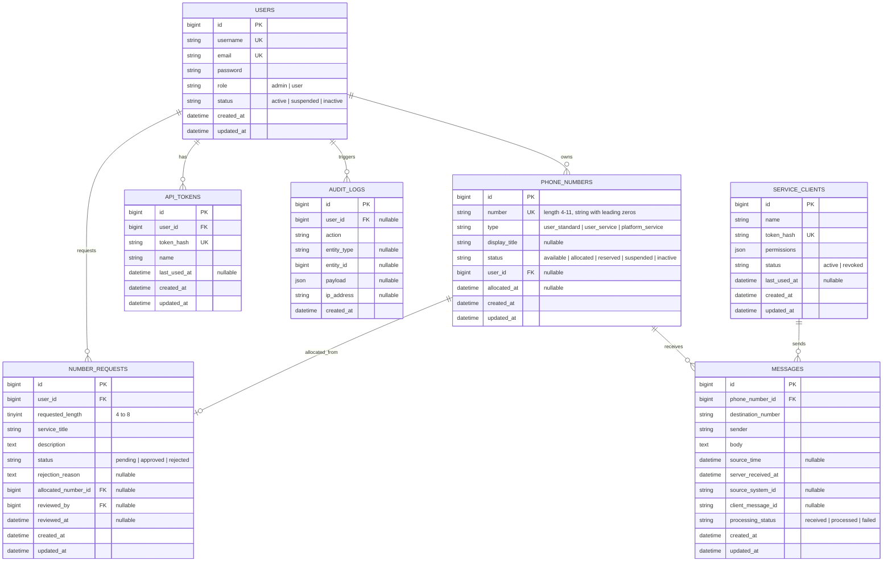

# سند جامع معماری و برنامه‌ریزی سیستم (Architecture & Technical Blueprint)
## سامانه مدیریت شماره‌های مجازی و پیام‌های داخلی (Virtual Number & Internal Messaging Management Platform)

---

## ۱. هدف و چشم‌انداز سامانه
این سامانه یک پلتفرم جامع برای مدیریت شماره‌های مجازی، تخصیص هوشمند و اتمیک شماره‌ها به کاربران، رسیدگی به درخواست سرشماره‌های اختصاصی (۴ تا ۸ رقم)، سرشماره‌های پلتفرم و دریافت و نمایش پیام‌های داخلی از طریق API امن است. این پلتفرم در این فاز فاقد درگاه مخابراتی یا ارسال واقعی پیامک بوده و صرفاً به عنوان یک گذرگاه ارتباطی داخلی برای مدیریت شناسه‌های ارتباطی و پیام‌های ثبت‌شده عمل می‌کند.

---

## ۲. بررسی محیط و سازگاری نسخه‌ها (Environment & Dependency Verification)

بررسی‌های انجام‌شده در محیط اجرایی سرور/توسعه به شرح زیر ثبت گردید:

| مؤلفه | نسخه مشاهده‌شده | وضعیت سازگاری | توضیحات فنی |
|---|---|---|---|
| **PHP** | `8.3.12 (CLI, x64)` | ✅ کاملاً سازگار | اکستنشن‌های ضروری نظیر `pdo_mysql`, `pdo_sqlite`, `bcmath`, `curl`, `intl`, `mbstring`, `zip`, `xml`, `openssl` فعال هستند. |
| **Composer** | `2.8.1` | ✅ کاملاً سازگار | ابزار مدیریت وابستگی‌های PHP |
| **Node.js** | `v22.17.0` | ✅ کاملاً سازگار | موتور اجرای ابزارهای فرانت‌اند |
| **npm** | `10.9.2` | ✅ کاملاً سازگار | مدیریت پکیج‌های جاوااسکریپت و تایپ‌اسکریپت |
| **Laravel Framework** | `13.x` (پکیج پایدار `v13.38.0`) | ✅ کاملاً سازگار | الزامات بسته `php ^8.3` بوده و با PHP 8.3.12 مطابقت ۱۰۰٪ دارد. |
| **Database** | `MariaDB 10.4.32` & `SQLite 3` | ✅ آماده | درایورهای `pdo_mysql` و `pdo_sqlite` فعال هستند. پشتیبانی از MySQL/MariaDB در محیط اجرایی و SQLite در تست‌های خودکار. |
| **Starter Kit** | `Laravel Breeze` (Vue 3 + Inertia + TypeScript) | ✅ سازگار | نسخه `2.4.x` سازگار با Laravel 13 و Vite |

---

## ۳. اصول معماری و Clean Code

### ۳.۱ اصول SOLID
1. **Single Responsibility Principle (SRP):** هر کلاس صرفاً مسئول یک وظیفه مشخص است. کنترلرها فقط مدیریت ورودی و خروجی HTTP را انجام می‌دهند؛ منطق تجاری به لایه Services/Actions منتقل می‌شود.
2. **Open/Closed Principle (OCP):** سیستم از طریق افزودن ماژول‌ها و سرویس‌های مستقل قابل توسعه است بدون نیاز به دستکاری کدهای پایدار قبلی.
3. **Liskov Substitution Principle (LSP):** پیاده‌سازی قراردادها و ساختار داده‌ها رفتاری پیش‌بینی‌پذیر و یکپارچه در سیستم دارند.
4. **Interface Segregation Principle (ISP):** جلوگیری از تعریف اینترفیس‌های حجیم؛ قراردادهای کوچک و هدفمند استفاده می‌شوند.
5. **Dependency Inversion Principle (DIP):** ماژول‌های رده‌بالا مستقیماً به جزئیات کم‌اهمیت وابسته نیستند و تزریق وابستگی (Dependency Injection) لاراول مبنای اتصال لایه‌هاست.

### ۳.۲ ساختار لایه‌بندی پروژه (Layered Architecture)
- **HTTP / Controllers:** کنترلرهای فوق‌العاده باریک (`Thin Controllers`)، بدون منطق بیزینس.
- **Form Requests:** اعتبارسنجی مستقل تمامی ورودی‌های فرم و API پیش از ورود به کنترلر.
- **Services / Actions:** پیاده‌سازی عملیات حساس تجاری (نظیر تخصیص شماره، اعتبارسنجی یکتایی، مدیریت تکرار پیام).
- **Policies:** بررسی مجوزهای امنیتی مبتنی بر کاربر و نقش در سطح سرور (`Server-side authorization`).
- **Models & Enums:** مدل‌های Eloquent سبک به همراه مقادیر ثابت و تایپ‌های قوی با PHP 8.3 Enums.
- **API Resources:** فرمت‌بندی و استانداردسازی پاسخ‌های خروجی API بدون نشت فیلدهای حساس.
- **Database Transactions:** تضمین اتمیک بودن تراکنش‌ها در تخصیص شماره و ثبت پیام به همراه `lockForUpdate`.

---

## ۴. استانداردهای فرانت‌اند و Blade

### ۴.۱ قوانین اجباری Blade
1. **عدم استفاده از تگ `<script>` در هیچ‌یک از فایل‌های Blade.**
2. **عدم استفاده از تگ `<style>` در هیچ‌یک از فایل‌های Blade.**
3. کلیه استایل‌ها در مسیر `resources/css` و فایل‌های Tailwind قرار می‌گیرند.
4. کلیه اسکریپت‌ها و کامپوننت‌های فرانت‌اند در مسیر `resources/js` با فرمت Vue 3 و TypeScript نگهداری می‌شوند.
5. فایل‌های Blade صرفاً شامل پوسته اصلی HTML (`app.blade.php`)، Layoutها، و Blade Partialهای ساختاری خواهند بود.
6. بارگذاری دارایی‌ها منحصراً از طریق `@vite` در قالب HTML کنترل می‌شود.

### ۴.۲ ساختار طراحی رابط کاربری (UI/UX)
- **RTL & زبان فارسی:** طراحی تمام صفحات به صورت پیش‌فرض راست‌به‌چپ (RTL) با فونت استاندارد خوانا (Vazirmatn).
- **Dark Mode & Light Mode:**
  - امکان تشخیص خودکار تم سیستم‌عامل (`prefers-color-scheme`).
  - امکان تغییر دستی توسط کاربر و ذخیره وضعیت در `localStorage` و پروفایل کاربر.
  - جلوگیری از پدیده پرش تم (FOUC) با اجرای اسکریپت در فایل اختصاصی JS مدیریت تم.
- **طراحی ریسپانسیو:** پشتیبانی از نمایش بی‌نقص در موبایل، تبلت و دسکتاپ.
- **Layoutهای مستقل:**
  - `GuestLayout`: برای صفحات عمومی و فرود
  - `AuthLayout`: برای ورود و ثبت‌نام
  - `UserLayout`: برای پنل اختصاصی کاربران عادی
  - `AdminLayout`: برای پنل مدیریت با دسترسی‌های سطح بالا

- ** توجه داشته باش لازم هست متن ها بطور رسمی و سازمانی باشند **
- ** هیچ لایبری نباید از بستر اینترنت در هربار اجرا فراخوان شود و باید حتما بصورت لوکال ریخته شود تا اگر اینترنت قطع شد دچار اختلال و مشکل نشویم. **
---

## ۵. طراحی دامنه و قوانین بیزینس (Domain Rules)

### ۵.۱ شماره عادی کاربران (Standard Numbers)
- **قالب:** پیشوند `+85` به همراه رشته عددی ۹ رقمی (`+85XXXXXXXXX`).
- **محدوده:** `000000000` تا `999999999`.
- **ذخیره‌سازی:** به صورت نوع داده `VARCHAR` (رشته‌ای) برای حفظ قطعی صفرهای ابتدایی.
- **تخصیص اتمیک:** استفاده از مکانیزم تراکنش ایزوله پایگاه داده (`DB::transaction`) و قفل سطری برای جلوگیری از تخصیص همزمان یک شماره به دو کاربر مختلف.
- **وضعیت‌ها:** آزاد (`available`)، تخصیص‌یافته (`allocated`)، رزروشده (`reserved`)، تعلیق‌شده (`suspended`)، غیرفعال (`inactive`).

### ۵.۲ سرشماره‌های اختصاصی مشتریان (Client Service Numbers)
- **طول مجاز:** ۴، ۵، ۶، ۷ و ۸ رقم.
- **گردش کار:** ثبت درخواست توسط کاربر (طول، عنوان سرویس، توضیح کاربرد) -> وضعیت `pending` -> بررسی توسط مدیر -> تأیید یا رد با درج دلیل -> تخصیص خودکار یا دستی شماره بدون تداخل.

### ۵.۳ سرشماره‌های اختصاصی پلتفرم (Platform Service Numbers)
- نوع شماره: `platform_service`.
- تحت مالکیت و مدیریت مستقیم سیستم و ادمین.
- **ایزوله‌سازی دسترسی:** کاربران عادی به هیچ عنوان حق ثبت پیام برای این شماره‌ها را نخواهند داشت.

### ۵.۴ سیاست نمایش عنوان یا شماره
- اگر شماره دارای عنوان نمایشی معتبر (`display_title`) باشد: نمایش عنوان سرویس.
- اگر شماره فاقد عنوان باشد: نمایش شماره با پیشوند `+85`.
- عنوان نمایشی فقط از جدول شماره استخراج می‌شود؛ فرستنده پیام نمی‌تواند عنوان را در متن یا بدنه پیام جعل کند.

### ۵.۵ مدیریت پیام‌ها و API
- پیام‌ها داخلی هستند (بدون پیامک مخابراتی).
- ساختار پیام: شناسه داخلی، شناسه شماره مقصد، مقدار شماره مقصد، فرستنده، متن پیام، زمان مبدأ، زمان سرور، شناسه سیستم مبدأ، شناسه یکتای پیام مبدأ (`client_message_id`)، وضعیت پردازش.
- **جلوگیری از پیام تکراری (Idempotency):** کلید ترکیبی `(source_system_id, client_message_id)` یکتا بوده و در صورت ارسال مجدد، خطای مشخص و وضعیت تکراری بدون ایجاد رکورد جدید برمی‌گرداند.
- **به‌روزرسانی پنل:** Polling خودکار در پنل کاربر هر ۳ تا ۵ ثانیه با فیلتر شناسه آخرین پیام برای کاهش بار سرور.

### ۵.۶ امنیت و توکن‌ها
- **توکن کاربر:** تولید توکن تصادفی امن، ذخیره فقط مقدار هش‌شده (`SHA-256`) در پایگاه داده، نمایش مقدار خام فقط یک‌بار هنگام تولید یا تعویض.
- امکان لغو فوری و تعویض توکن.
- توکن سیستم‌های متصل: دارای مجوزها و محدودیت‌های دامنه مجزا.
- اعمال Rate Limiting استاندارد برای API و مسیرهای ورود.

---

## ۶. شمای مفهومی پایگاه داده (Database Schema Blueprint)

---

## ۷. نقشه راه و فازبندی اجرایی (Phase Roadmap & Acceptance Criteria)

| فاز | عنوان فاز | خروجی اصلی | معیارهای پذیرش (Acceptance Criteria) | وضعیت |
|:---:|:---|:---|:---|:---:|
| **۰** | **بررسی محیط و برنامه‌ریزی** | بررسی پیش‌نیازها، تأیید سازگاری، نگارش سند معماری، تدوین معیارهای فازها | ۱. تایید نسخه‌های PHP، Composer، Node، MariaDB/SQLite. ۲. ثبت کامل سند معماری در `docs/architecture.md`. ۳. عدم پیاده‌سازی زودهنگام کدهای بیزینس در فاز ۰. | **انجام شد** |
| **۱** | **اسکلت پروژه و رابط پایه** | نصب Laravel 13، Vue 3، TypeScript، Tailwind CSS، Inertia.js، تنظیم RTL، دارک مود، Layoutها | ۱. پروژه بدون خطا Build شود (`npm run build`). ۲. تم دارک/لایت بدون FOUC کار کند. ۳. هیچ تگ `script` یا `style` در فایل‌های Blade نباشد. ۴. Layoutهای استاندارد ایجاد شوند. | **انجام شد (این مرحله)** |
| **۲** | **احراز هویت و نقش‌ها** | ثبت‌نام، ورود، خروج، مدیریت نشست، نقش‌های Admin و User، مدیریت کاربران توسط مدیر | ۱. تفکیک کامل دسترسی کاربر و ادمین در سمت سرور. ۲. تست‌های خودکار احراز هویت با موفقیت پاس شوند. ۳. عدم دسترسی کاربران به پنل یکدیگر. | گام بعدی |
| **۳** | **مدل شماره و موتور تخصیص** | جداول و مدل شماره، تولید شماره ۹ رقمی و ۴ تا ۸ رقمی با حفظ صفرها، تخصیص اتمیک، پیشگیری از تکرار | ۱. هیچ شماره تکراری به دو مالک تخصیص داده نشود. ۲. حفظ کامل صفرهای ابتدایی به عنوان رشته. ۳. پاس شدن تست همزمانی تخصیص شماره. | در انتظار |
| **۴** | **درخواست سرشماره اختصاصی** | فرم درخواست، انتخاب طول ۴-۸ رقم، گردش کار تأیید/رد توسط ادمین، تخصیص خودکار/دستی | ۱. تخصیص شماره فقط پس از تأیید مدیر. ۲. ثبت دلیل در صورت رد درخواست. ۳. ثبت رویداد و تست کامل فلوی کاربری و مدیریتی. | در انتظار |
| **۵** | **API و مدیریت توکن** | معماری توکن‌های هش‌شده، تعویض و ابطال توکن، API احراز هویت، Rate Limiting | ۱. نمایش توکن خام صرفاً یک‌بار پس از تولید. ۲. لغو فوری دسترسی با تعویض یا ابطال توکن. ۳. ایزوله‌سازی توکن کاربر و سیستم‌های متصل. | در انتظار |
| **۶** | **مدیریت پیام‌ها** | API دریافت پیام، اعتبارسنجی مقصد و فرستنده، پیشگیری از تکرار با `client_message_id`، نمایش در پنل و Polling | ۱. رد درخواست‌های تکراری با شناسه یکتای پیام مبدأ. ۲. نمایش پیام‌ها فقط به مالک شماره مجاز. ۳. به‌روزرسانی زنده ۳-۵ ثانیه با مصرف بهینه. | در انتظار |
| **۷** | **سرشماره‌های پلتفرم** | سرشماره‌های اختصاصی پلتفرم، نمایش عنوان به جای شماره، محدودسازی دسترسی ثبت پیام | ۱. منع کامل کاربران عادی از ثبت پیام برای شماره‌های پلتفرم. ۲. نمایش صحیح عنوان سرویس در تمام لایه‌ها. | در انتظار |
| **۸** | **پنل مدیریت کامل** | داشبورد مدیریت، مدیریت کاربران، شماره‌ها، درخواست‌ها، پیام‌ها، سیستم‌ها و گزارش رویدادها | ۱. کلیه فرآیندهای مدیریتی از UI قابل انجام باشد. ۲. کنترل دسترسی دقیق در تمامی متدهای ادمین. | در انتظار |
| **۹** | **سخت‌سازی و تست نهایی** | تست‌های یکپارچه، امنیت، N+1 Query، بهینه‌سازی ایندکس‌ها، مستندات استقرار | ۱. اجرای ۱۰۰٪ تست‌های واحد و Feature با موفقیت. ۲. نبود آسیب‌پذیری‌های متداول امنیتی و خطاهای بیلد. | در انتظار |
| **۱۰** | **آماده‌سازی توسعه مالی** | مستندسازی نقاط اتصال مالی (قیمت‌گذاری، اشتراک، پرداخت، فاکتور) بدون کدهای اضافی | ۱. ارائه سند شفاف توسعه مالی برای آینده بدون شلوغ کردن دیتابیس فعلی. | در انتظار |

---

## ۸. گام‌های فاز بعدی (فاز ۱)
در فاز یک، زیرساخت پروژه به شرح زیر راه‌اندازی و تست خواهد شد:
1. ایجاد اسکلت اولیه پروژه Laravel 13 با پیکربندی کامل Composer.
2. راه‌اندازی Inertia.js، Vue 3 با کامپوزیشن API و TypeScript.
3. پیکربندی Tailwind CSS با متغیرهای طراحی و تنظیمات RTL.
4. پیاده‌سازی قالب پایه Blade بدون تگ‌های `script` و `style` و اتصال به Vite.
5. پیاده‌سازی سوییچر Dark/Light Mode و تست موفقیت‌آمیز Build پروژه.
