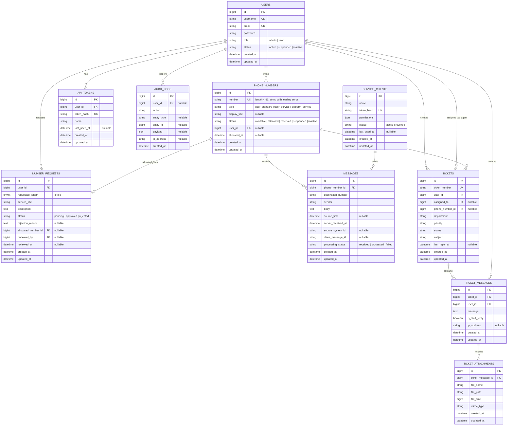

# سند جامع معماری و برنامه‌ریزی سیستم (Architecture & Technical Blueprint)
## سامانه مدیریت شماره‌های مجازی و پیام‌های داخلی (Virtual Number & Internal Messaging Management Platform)

---

## ۱. هدف و چشم‌انداز سامانه
این سامانه یک پلتفرم جامع برای مدیریت شماره‌های مجازی، تخصیص هوشمند و اتمیک شماره‌ها به کاربران، رسیدگی به درخواست سرشماره‌های اختصاصی (۴ تا ۸ رقم)، سرشماره‌های پلتفرم و دریافت و نمایش پیام‌های داخلی از طریق API امن است. این پلتفرم در این فاز فاقد درگاه مخابراتی یا ارسال واقعی پیامک بوده و صرفاً به عنوان یک گذرگاه ارتباطی داخلی برای مدیریت شناسه‌های ارتباطی و پیام‌های ثبت‌شده عمل می‌کند.

---

## ۲. بررسی محیط و سازگاری نسخه‌ها (Environment & Dependency Verification)

بررسی‌های انجام‌شده در محیط اجرایی سرور/توسعه به شرح زیر ثبت گردید:

| مؤلفه | نسخه مشاهده‌شده | وضعیت سازگاری | توضیحات فنی |
|---|---|---|---|
| **PHP** | `8.3.12 (CLI, x64)` | ✅ کاملاً سازگار | اکستنشن‌های ضروری نظیر `pdo_mysql`, `pdo_sqlite`, `bcmath`, `curl`, `intl`, `mbstring`, `zip`, `xml`, `openssl` فعال هستند. |
| **Composer** | `2.8.1` | ✅ کاملاً سازگار | ابزار مدیریت وابستگی‌های PHP |
| **Node.js** | `v22.17.0` | ✅ کاملاً سازگار | موتور اجرای ابزارهای فرانت‌اند |
| **npm** | `10.9.2` | ✅ کاملاً سازگار | مدیریت پکیج‌های جاوااسکریپت و تایپ‌اسکریپت |
| **Laravel Framework** | `13.x` (پکیج پایدار `v13.38.0`) | ✅ کاملاً سازگار | الزامات بسته `php ^8.3` بوده و با PHP 8.3.12 مطابقت ۱۰۰٪ دارد. |
| **Database** | `MariaDB 10.4.32` & `SQLite 3` | ✅ آماده | درایورهای `pdo_mysql` و `pdo_sqlite` فعال هستند. پشتیبانی از MySQL/MariaDB در محیط اجرایی و SQLite در تست‌های خودکار. |
| **Starter Kit** | `Laravel Breeze` (Vue 3 + Inertia + TypeScript) | ✅ سازگار | نسخه `2.4.x` سازگار با Laravel 13 و Vite |

---

## ۳. اصول معماری و Clean Code

### ۳.۱ اصول SOLID
1. **Single Responsibility Principle (SRP):** هر کلاس صرفاً مسئول یک وظیفه مشخص است. کنترلرها فقط مدیریت ورودی و خروجی HTTP را انجام می‌دهند؛ منطق تجاری به لایه Services/Actions منتقل می‌شود.
2. **Open/Closed Principle (OCP):** سیستم از طریق افزودن ماژول‌ها و سرویس‌های مستقل قابل توسعه است بدون نیاز به دستکاری کدهای پایدار قبلی.
3. **Liskov Substitution Principle (LSP):** پیاده‌سازی قراردادها و ساختار داده‌ها رفتاری پیش‌بینی‌پذیر و یکپارچه در سیستم دارند.
4. **Interface Segregation Principle (ISP):** جلوگیری از تعریف اینترفیس‌های حجیم؛ قراردادهای کوچک و هدفمند استفاده می‌شوند.
5. **Dependency Inversion Principle (DIP):** ماژول‌های رده‌بالا مستقیماً به جزئیات کم‌اهمیت وابسته نیستند و تزریق وابستگی (Dependency Injection) لاراول مبنای اتصال لایه‌هاست.

### ۳.۲ ساختار لایه‌بندی پروژه (Layered Architecture)
- **HTTP / Controllers:** کنترلرهای فوق‌العاده باریک (`Thin Controllers`)، بدون منطق بیزینس.
- **Form Requests:** اعتبارسنجی مستقل تمامی ورودی‌های فرم و API پیش از ورود به کنترلر.
- **Services / Actions:** پیاده‌سازی عملیات حساس تجاری (نظیر تخصیص شماره، اعتبارسنجی یکتایی، مدیریت تکرار پیام).
- **Policies:** بررسی مجوزهای امنیتی مبتنی بر کاربر و نقش در سطح سرور (`Server-side authorization`).
- **Models & Enums:** مدل‌های Eloquent سبک به همراه مقادیر ثابت و تایپ‌های قوی با PHP 8.3 Enums.
- **API Resources:** فرمت‌بندی و استانداردسازی پاسخ‌های خروجی API بدون نشت فیلدهای حساس.
- **Database Transactions:** تضمین اتمیک بودن تراکنش‌ها در تخصیص شماره و ثبت پیام به همراه `lockForUpdate`.

---

## ۴. استانداردهای فرانت‌اند و Blade

### ۴.۱ قوانین اجباری Blade
1. **عدم استفاده از تگ `<script>` در هیچ‌یک از فایل‌های Blade.**
2. **عدم استفاده از تگ `<style>` در هیچ‌یک از فایل‌های Blade.**
3. کلیه استایل‌ها در مسیر `resources/css` و فایل‌های Tailwind قرار می‌گیرند.
4. کلیه اسکریپت‌ها و کامپوننت‌های فرانت‌اند در مسیر `resources/js` با فرمت Vue 3 و TypeScript نگهداری می‌شوند.
5. فایل‌های Blade صرفاً شامل پوسته اصلی HTML (`app.blade.php`)، Layoutها، و Blade Partialهای ساختاری خواهند بود.
6. بارگذاری دارایی‌ها منحصراً از طریق `@vite` در قالب HTML کنترل می‌شود.

### ۴.۲ ساختار طراحی رابط کاربری (UI/UX)
- **RTL & زبان فارسی:** طراحی تمام صفحات به صورت پیش‌فرض راست‌به‌چپ (RTL) با فونت استاندارد خوانا (Vazirmatn).
- **Dark Mode & Light Mode:**
  - امکان تشخیص خودکار تم سیستم‌عامل (`prefers-color-scheme`).
  - امکان تغییر دستی توسط کاربر و ذخیره وضعیت در `localStorage` و پروفایل کاربر.
  - جلوگیری از پدیده پرش تم (FOUC) با اجرای اسکریپت در فایل اختصاصی JS مدیریت تم.
- **طراحی ریسپانسیو:** پشتیبانی از نمایش بی‌نقص در موبایل، تبلت و دسکتاپ.
- **Layoutهای مستقل:**
  - `GuestLayout`: برای صفحات عمومی و فرود
  - `AuthLayout`: برای ورود و ثبت‌نام
  - `UserLayout`: برای پنل اختصاصی کاربران عادی
  - `AdminLayout`: برای پنل مدیریت با دسترسی‌های سطح بالا

- ** توجه داشته باش لازم هست متن ها بطور رسمی و سازمانی باشند **
- ** هیچ لایبری نباید از بستر اینترنت در هربار اجرا فراخوان شود و باید حتما بصورت لوکال ریخته شود تا اگر اینترنت قطع شد دچار اختلال و مشکل نشویم. **
---

## ۵. طراحی دامنه و قوانین بیزینس (Domain Rules)

### ۵.۱ شماره عادی کاربران (Standard Numbers)
- **قالب:** پیشوند `+85` به همراه رشته عددی ۹ رقمی (`+85XXXXXXXXX`).
- **محدوده:** `000000000` تا `999999999`.
- **ذخیره‌سازی:** به صورت نوع داده `VARCHAR` (رشته‌ای) برای حفظ قطعی صفرهای ابتدایی.
- **تخصیص اتمیک:** استفاده از مکانیزم تراکنش ایزوله پایگاه داده (`DB::transaction`) و قفل سطری برای جلوگیری از تخصیص همزمان یک شماره به دو کاربر مختلف.
- **وضعیت‌ها:** آزاد (`available`)، تخصیص‌یافته (`allocated`)، رزروشده (`reserved`)، تعلیق‌شده (`suspended`)، غیرفعال (`inactive`).

### ۵.۲ سرشماره‌های اختصاصی مشتریان (Client Service Numbers)
- **طول مجاز:** ۴، ۵، ۶، ۷ و ۸ رقم.
- **گردش کار:** ثبت درخواست توسط کاربر (طول، عنوان سرویس، توضیح کاربرد) -> وضعیت `pending` -> بررسی توسط مدیر -> تأیید یا رد با درج دلیل -> تخصیص خودکار یا دستی شماره بدون تداخل.

### ۵.۳ سرشماره‌های اختصاصی پلتفرم (Platform Service Numbers)
- نوع شماره: `platform_service`.
- تحت مالکیت و مدیریت مستقیم سیستم و ادمین.
- **ایزوله‌سازی دسترسی:** کاربران عادی به هیچ عنوان حق ثبت پیام برای این شماره‌ها را نخواهند داشت.

### ۵.۴ سیاست نمایش عنوان یا شماره
- اگر شماره دارای عنوان نمایشی معتبر (`display_title`) باشد: نمایش عنوان سرویس.
- اگر شماره فاقد عنوان باشد: نمایش شماره با پیشوند `+85`.
- عنوان نمایشی فقط از جدول شماره استخراج می‌شود؛ فرستنده پیام نمی‌تواند عنوان را در متن یا بدنه پیام جعل کند.

### ۵.۵ مدیریت پیام‌ها و سیستم مکالمه پیامکی (Mobile SMS & Conversations)
- **محیط پیامک موبایلی کاربر (Mobile SMS & Conversations):**
  - سازماندهی پیام‌ها به صورت مکالمه (Thread) بر اساس شماره طرف مقابل (`peer_number`) و خط فعال انتخابی کاربر.
  - سوییچ خط فعال (مانند دو سیم‌کارته در تلفن همراه): کاربر با جابجایی بین خطوط اختصاصی خود، گفتگوهای مربوط به آن خط را مشاهده و مدیریت می‌کند.
  - پیام‌رسانی کاربر به کاربر: ثبت اتمیک پیام ارسالی (`outbound`) برای خط فرستنده و پیام دریافتی (`inbound`) برای خط گیرنده.
  - باکس یکپارچه دریافت‌کنندگان (To: [Chips]): انتخاب سریع شماره‌های دیگر کاربر یا وارد کردن چند شماره برای ارسال گروهی بدون مدال‌های مزاحم.
  - اعتبارسنجی سرشماره‌های غیر ۹ رقمی: بررسی دسترسی خطوط خدماتی (۴ تا ۸ رقم) و پلتفرم، بررسی فعال بودن قابلیت دریافت پیامک (`accepts_incoming_sms`) و منع کاربران از ارسال پیام به خطوط یک‌طرفه اطلاع‌رسانی پلتفرم.
  - جستجوی بلادرنگ در پیام‌ها: جستجو هم در شماره/عنوان مخاطب و هم در متن پیام‌های ردو‌بدل‌شده.
- **محیط نظارت و چت مدیریت سامانه (Admin Chat & Conversation Inspector):**
  - نمایش کلیه تبادلات پیامکی سامانه در قالب محیط چت دوطرفه و گفتگو محور (کی به کی پیام داده).
  - تفکیک شفاف طرفین گفتگو: مشخصات خط A (شماره، کاربر مالک، عنوان)، آیکون جهت `⇄`، و مشخصات خط B (شماره، کاربر مالک یا فرستنده خارجی).
  - حباب‌های گفتگوی تعاملی با برچسب صریح فرستنده و گیرنده، زمان تحویل، وضعیت پردازش و شناسه فنی پیام.
  - سوییچ بین «نمای چت و مکالمات» (پیش‌فرض) و «جدول لاگ‌های خام» برای ممیزی فنی و بازرسی امنیتی.
  - قابلیت ارسال پیامک مدیریتی مستقیماً از داخل محیط چت به هر یک از گفتگوها.
- **جلوگیری از پیام تکراری (Idempotency):** کلید ترکیبی `(source_system_id, client_message_id)` یکتا بوده و در صورت ارسال مجدد وب‌هوک، خطای تکراری بدون ایجاد رکورد جدید برمی‌گرداند.
- **به‌روزرسانی کاملاً نامحسوس پنل:** اجرای Polling خودکار هر ۴ ثانیه در پس‌زمینه بدون نمایش نشانگر مزاحم یا دکمه توقف توسط کاربر و مدیریت هوشمند بر مبنای Page Visibility API.

### ۵.۶ امنیت و توکن‌ها
- **توکن کاربر:** تولید توکن تصادفی امن، ذخیره فقط مقدار هش‌شده (`SHA-256`) در پایگاه داده، نمایش مقدار خام فقط یک‌بار هنگام تولید یا تعویض.
- امکان لغو فوری و تعویض توکن.
- توکن سیستم‌های متصل: دارای مجوزها و محدودیت‌های دامنه مجزا.
- اعمال Rate Limiting استاندارد برای API و مسیرهای ورود.

---

## ۶. شمای مفهومی پایگاه داده (Database Schema Blueprint)

---

## ۷. نقشه راه و فازبندی اجرایی (Phase Roadmap & Acceptance Criteria)

| فاز | عنوان فاز | خروجی اصلی | معیارهای پذیرش (Acceptance Criteria) | وضعیت |
|:---:|:---|:---|:---|:---:|
| **۰** | **بررسی محیط و برنامه‌ریزی** | بررسی پیش‌نیازها، تأیید سازگاری، نگارش سند معماری، تدوین معیارهای فازها | ۱. تایید نسخه‌های PHP، Composer، Node، MariaDB/SQLite. ۲. ثبت کامل سند معماری در `docs/architecture.md`. ۳. عدم پیاده‌سازی زودهنگام کدهای بیزینس در فاز ۰. | **انجام شد** |
| **۱** | **اسکلت پروژه و رابط پایه** | نصب Laravel 13، Vue 3، TypeScript، Tailwind CSS، Inertia.js، تنظیم RTL، دارک مود، Layoutها | ۱. پروژه بدون خطا Build شود (`npm run build`). ۲. تم دارک/لایت بدون FOUC کار کند. ۳. هیچ تگ `script` یا `style` در فایل‌های Blade نباشد. ۴. Layoutهای استاندارد ایجاد شوند. | **انجام شد (این مرحله)** |
| **۲** | **احراز هویت و نقش‌ها** | ثبت‌نام، ورود، خروج، مدیریت نشست، نقش‌های Admin و User، مدیریت کاربران توسط مدیر | ۱. تفکیک کامل دسترسی کاربر و ادمین در سمت سرور. ۲. تست‌های خودکار احراز هویت با موفقیت پاس شوند. ۳. عدم دسترسی کاربران به پنل یکدیگر. ۴. حذف قطعی و کامل ایمیل و ورود با نام کاربری و رمز. | **انجام شد** |
| **۳** | **مدل شماره و موتور تخصیص** | جداول و مدل شماره، تولید شماره ۹ رقمی و ۴ تا ۸ رقمی با حفظ صفرها، تخصیص اتمیک، پیشگیری از تکرار | ۱. هیچ شماره تکراری به دو مالک تخصیص داده نشود. ۲. حفظ کامل صفرهای ابتدایی به عنوان رشته. ۳. پاس شدن تست‌های همزمانی و تخصیص شماره. ۴. لاگ رویدادها، آزادسازی شماره و رعایت سقف مصرف. | **انجام شد** |
| **۴** | **درخواست سرشماره اختصاصی** | فرم درخواست، انتخاب طول ۴-۸ رقم، گردش کار تأیید/رد توسط ادمین، تخصیص خودکار/دستی | ۱. تخصیص شماره فقط پس از تأیید مدیر. ۲. ثبت دلیل در صورت رد درخواست. ۳. ثبت رویداد و تست کامل فلوی کاربری و مدیریتی. ۴. رابط کاربری کامل کاربر و ادمین با اعتبارسنجی دقیق. | **انجام شد (این مرحله)** |
| **۵** | **API و مدیریت توکن** | معماری توکن‌های هش‌شده (SHA-256)، تعویض و ابطال توکن، API احراز هویت، Rate Limiting سازمانی (۶۰ req/min)، رابط کاربری کاربر و ادمین | ۱. نمایش توکن خام صرفاً یک‌بار پس از تولید و ذخیره یک‌طرفه SHA-256. ۲. لغو فوری دسترسی با تعویض یا ابطال توکن. ۳. ایزوله‌سازی توکن کاربر و سیستم‌های متصل. ۴. پوشش کامل با ۱۶ تست اختصاصی و پاس شدن ۹۴ تست کلی پروژه. | **انجام شد** |
| **۶** | **مدیریت پیام‌ها** | مدل و جداول پیام‌ها، API دریافت پیام، اعتبارسنجی مقصد و فرستنده، پیشگیری از تکرار با `client_message_id`، نمایش در پنل کاربری و پولینگ زنده | ۱. رد درخواست‌های تکراری با شناسه یکتای پیام مبدأ (Idempotency). ۲. نمایش پیام‌ها فقط به مالک شماره مجاز در پنل و API. ۳. به‌روزرسانی زنده ۳-۵ ثانیه با مصرف بهینه و آگاهی از تب مرورگر. ۴. مانیتورینگ متمرکز و قابلیت بازرسی و حذف پیام در پنل ادمین. ۵. پاس شدن ۱۲ تست اختصاصی و ۱۱۲ تست کل سیستم. | **انجام شد** |
| **۷** | **سرشماره‌های پلتفرم** | سرشماره‌های اختصاصی پلتفرم، نمایش عنوان به جای شماره، محدودسازی دسترسی ثبت پیام | ۱. منع کامل کاربران عادی از ثبت، ارسال یا تخصیص خطوط پلتفرم. ۲. استخراج و نمایش قطعی عنوان سرویس در تمام لایه‌ها بدون امکان جعل عنوان. ۳. مدیریت خطوط یک‌طرفه/دوطرفه با فلگ `accepts_incoming_sms`. ۴. پوشش کامل با ۱۲ تست اختصاصی و ۱۳۵ تست پاس شده کل سیستم. | **انجام شد** |
| **۸** | **پنل مدیریت کامل** | داشبورد مدیریت، مدیریت کاربران، شماره‌ها، درخواست‌ها، پیام‌ها، سیستم‌ها و گزارش رویدادها | ۱. کلیه فرآیندهای مدیریتی از UI قابل انجام باشد. ۲. کنترل دسترسی دقیق در تمامی متدهای ادمین. ۳. داشبورد آمار تحلیلی و مانیتورینگ متمرکز لحظه‌ای. ۴. سیستم جامع ممیزی رویدادها (`Audit Logs`) با لاگ تغییرات کاربران، شماره‌ها، توکن‌ها و درخواست‌ها همراه با بازرسی JSON Payload. ۵. پوشش کامل با ۱۰ تست اختصاصی و پاس شدن ۱۴۵ تست کلی سیستم. | **انجام شد** |
| **۹** | **سخت‌سازی و تست نهایی** | تست‌های یکپارچه، امنیت، N+1 Query، بهینه‌سازی ایندکس‌ها، مستندات استقرار | ۱. اجرای ۱۰۰٪ تست‌های واحد و Feature با موفقیت. ۲. نبود آسیب‌پذیری‌های متداول امنیتی و خطاهای بیلد. | در انتظار |
| **۱۰** | **آماده‌سازی توسعه مالی** | مستندسازی نقاط اتصال مالی (قیمت‌گذاری، اشتراک، پرداخت، فاکتور) بدون کدهای اضافی | ۱. ارائه سند شفاف توسعه مالی برای آینده بدون شلوغ کردن دیتابیس فعلی. | در انتظار |

---

## ۸. خلاصه دستاوردهای فاز ۸ و گام‌های فاز بعدی (فاز ۹: سخت‌سازی، امنیت و بهینه‌سازی نهایی)

### خروجی‌های محقق‌شده در فاز ۸:
1. **داشبورد تحلیلی متمرکز مدیریت (`Admin/Dashboard.vue` و `DashboardController.php`)**:
   - پایش بلادرنگ ۵ حوزه کلیدی: کاربران (فعال/تعلیق/راهبر)، استخر خطوط و ضریب بهره‌وری (`utilization_rate`)، ترافیک و درصد موفقیت تحویل پیام‌ها (`delivery success rate`)، درخواست‌های معلق سرشماره با هشدار فعال، و وضعیت کلیدهای وب‌سرویس.
   - نوار دسترسی‌های سریع سازمانی (Quick Actions) برای هدایت سریع به تأیید درخواست‌ها، مانیتورینگ چت و پیام‌ها، تولید شماره، و ممیزی سیستم.
   - ویجت درخواست‌های در انتظار با امکان بررسی و اقدام مستقیم.
   - فید لحظه‌ای رخدادهای حساس امنیتی با نمایش امضای آی‌پی، عامل مجری و برچسب‌های رنگی رویدادها.
2. **سامانه ممیزی و رخدادنگاری جامع (`AuditLog` و `/admin/audit-logs`)**:
   - جدول و مدل ساختاریافته `audit_logs` مطابق با ERD معماری.
   - پیاده‌سازی متد `AuditLog::record(...)` برای ثبت کلیه تغییرات در عملیات کاربران (ایجاد، ویرایش، تعلیق)، خطوط سازمانی (تولید، تخصیص، آزادسازی، تغییر وضعیت)، درخواست‌های سرشماره (تأیید و رد)، کلیدهای وب‌سرویس (صدور، تعویض، ابطال) و پیام‌ها.
   - صفحه مدیریتی مدرن `Admin/AuditLogs/Index.vue` با فیلترهای پیشرفته بر اساس نوع رخداد، تاریخ، کاربر مجری، آدرس IP و شناسه موجودیت.
   - مدال اختصاصی بازرسی عمیق متادیتا و JSON Payload با قابلیت کپی مستقیم و قالب‌بندی LTR.
3. **تست‌های خودکار Feature و یکپارچگی**:
   - تدوین فایل تست `tests/Feature/Admin/AdminDashboardAndAuditTest.php` شامل ۱۰ سناریوی تست و ۷۶ assertion تاییدشده.
   - تضمین اجرای بدون خطای تمامی ۱۴۵ تست سیستم (۶۱۰ assertions) و کامپایل بیلد پاک فرانت‌اند (`npm run build`).

### گام‌های فاز ۹ (سخت‌سازی، امنیت، بررسی N+1 و تست نهایی):
1. ممیزی کوئری‌ها جهت پیشگیری از N+1 Query در لیست‌های بزرگ.
2. اعتبارسنجی و بهینه‌سازی ایندکس‌های دیتابیس برای ترافیک سازمانی بالا.
3. ممیزی امنیتی نهایی CSRF ،XSS ،Rate-Limiting و سطوح دسترسی RBAC.
4. آماده‌سازی راهنمای استقرار سازمانی (Deployment Guide).

---

## ۹. سامانه تیکتینگ و پشتیبانی پیشرفته سازمانی (Support Ticketing System)

### ۹.۱. اهداف و نیازمندی‌ها
- امکان ثبت تیکت پشتیبانی توسط مشترک با امکان تعیین دپارتمان (`technical`, `numbers`, `api`, `general`)، اولویت (`low`, `medium`, `high`, `urgent`) و اتصال اختیاری به شماره‌های تخصیص‌یافته (`phone_number_id`).
- ایجاد رشته گفتگوی چندطرفه و پیوسته (Multi-reply Thread) میان مشترک، کارشناسان پشتیبانی (`agent`) و راهبران سیستم (`admin`).
- پشتیبانی کامل از فایل‌های پیوست (JPG, PNG, PDF, ZIP, TXT) تا سقف ۵ مگابایت به ازای هر فایل و حداکثر ۵ فایل در هر پیام.
- **ایزوله‌سازی و امنیت فایل‌ها:** عدم ذخیره‌سازی فایل‌ها در دایرکتوری عمومی (`public`) و میزبانی در حافظه محلی محافظت‌شده سرور (`storage/app/private/tickets/{id}/...`) با کنترل سطح دسترسی قبل از استریم دانلود.
- کنترل نقش‌ها: تعریف نقش `agent` (کارشناس پشتیبانی) در کنار `admin` و `user`؛ مشترکان فقط تیکت‌های خود را مشاهده می‌کنند و کارشناسان/مدیران به صف کلیه تیکت‌ها دسترسی دارند و می‌توانند تیکت را به کارشناس خاصی ارجاع دهند (`assignTicket`).
- ثبت کامل وقایع در زنجیره ممیزی امنیتی (`AuditLog`).

### ۹.۲. ساختار مدل‌ها و انتزاع
1. **مدل `Ticket`**: شماره تیکت یکتا با پیشوند `TK-` (تولید خودکار اتمیک)، وضعیت‌ها (`open`, `in_progress`, `answered`, `closed`)، انتساب به کارشناس (`assigned_to`)، ارتباط با خط مشترک.
2. **مدل `TicketMessage`**: پیام‌های تبادل‌شده به همراه فلگ `is_staff_reply` و آی‌پی فرستنده.
3. **مدل `TicketAttachment`**: نگهداری مشخصات فایل، نوع محتوا (MIME) و مسیر محلی ذخیره‌سازی.
4. **سرویس `TicketService`**: پیاده‌سازی اینترفیس `TicketServiceInterface` و کپسوله‌سازی منطق تراکنشی ایجاد تیکت، ثبت پاسخ، تغییر وضعیت و ارجاع.
5. **سیاست دسترسی `TicketPolicy`**: کنترل دقیق RBAC در سطح روت‌ها و کنش‌ها (`view`, `reply`, `downloadAttachment`, `manage`, `close`).
6. **میدلور `EnsureUserIsStaff`**: فیلتر ترافیک کنسول کارشناسان (`agent` و `admin`) با نام مستعار `'staff'`.

### ۹.۳. پوشش تست خودکار
- فایل تست `tests/Feature/Tickets/TicketSystemTest.php` با ۱۲ سناریوی آزمون و ۱۰۶ assertion تاییدشده.
- مجموع تست‌های پروژه به **۱۵۷ تست با ۷۱۶ assertion موفق** ارتقا یافت.

